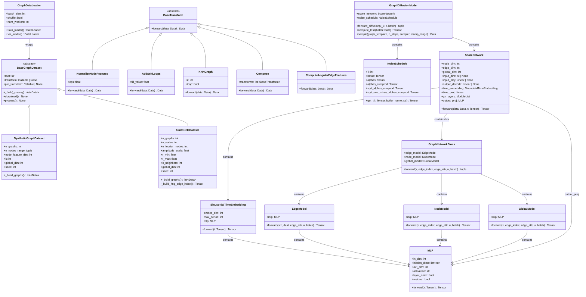
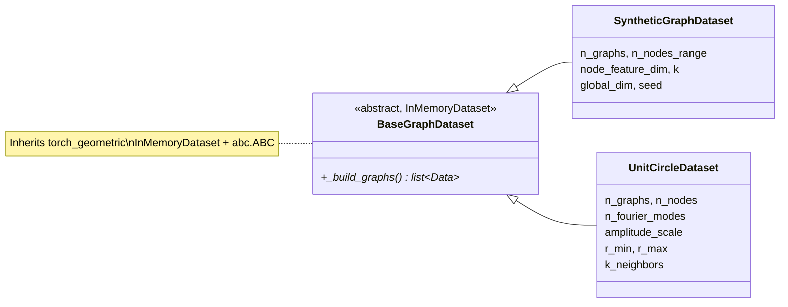
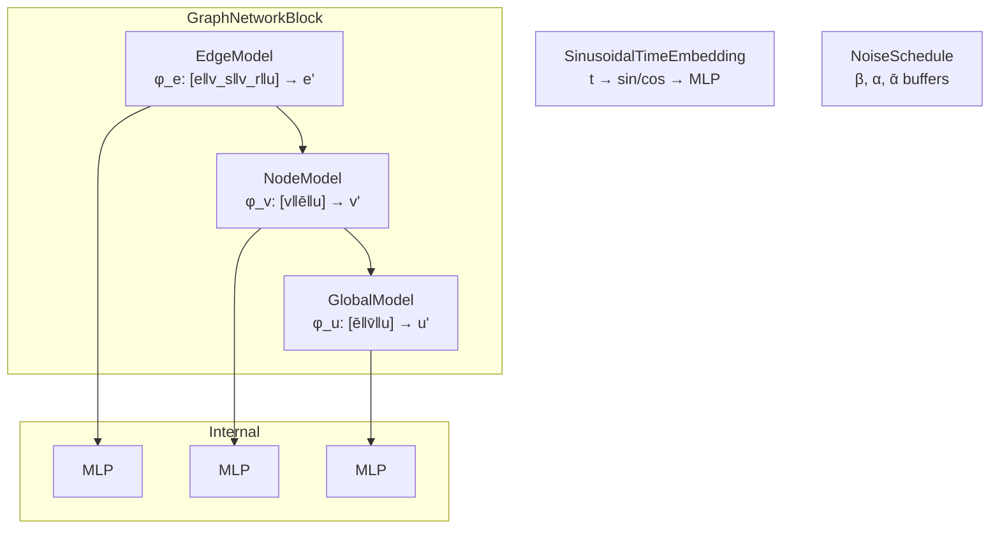
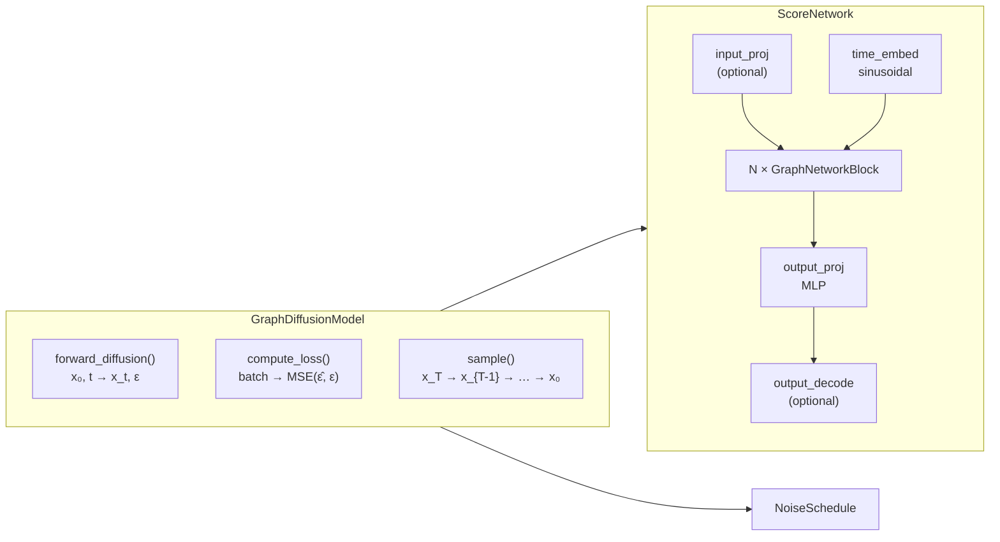
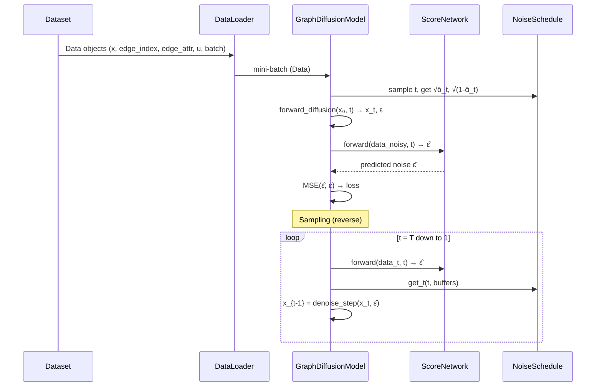

# Architecture Overview

This document describes the full class hierarchy of the `graph_diffusion`
package.  All diagrams use Mermaid and render natively in Obsidian.

> **Vault tip:** Enable the *Mermaid* core plugin in Obsidian settings
> (Settings → Core plugins → toggle on) to render diagrams inline.

---

## Package dependency graph

The sub-packages form a strict DAG — no circular dependencies allowed.

```mermaid
graph TD
    subgraph graph_diffusion
        data["data/"]
        bb["building_blocks/"]
        model["model/"]
        viz["visualisation/"]
    end

    model -->|imports| bb
    model -.->|"uses at runtime<br/>(Data objects)"| data
    viz -->|"reads raw HDF5<br/>(pOnEllipse)"| data
    data -.x bb
    data -.x model
    bb -.x data
    viz -.x model
    viz -.x bb

    style data fill:#4a9eff,stroke:#333,color:#fff
    style bb fill:#ff9f43,stroke:#333,color:#fff
    style model fill:#ee5a24,stroke:#333,color:#fff
    style viz fill:#10ac84,stroke:#333,color:#fff
```

**Rule:** `data` and `building_blocks` have **no** upstream dependencies.
`model` depends on `building_blocks` only. `visualisation` is read-only and depends on
`data` (the pOnEllipse raw arrays) only — never on `model/` or `building_blocks/`.
Data objects (`torch_geometric.data.Data`) flow through the system without creating
import dependencies.

---

## Full class diagram



---

## Sub-package details

### `data/` — datasets & transforms



### `building_blocks/` — reusable components



### `model/` — diffusion pipeline



### `visualisation/` — dataset overview suite (read-only)

`dataset_overview.py` is a read-only analysis module operating on the raw pOnEllipse
HDF5 arrays (`[x, y, Re, H, p0..p100]`). It imports nothing from `model/` or
`building_blocks/`, preserving the one-way DAG.

- **`pressure_drag_coefficient(polygon_xy, cp)`** — discrete line integral
  `Cd_p = ∮ Cp (n·x̂) ds`. Pressure drag only (the dataset is pressure-only; no skin
  friction).
- **`sim_summary(raw, idx)`** — per-sim accessor returning `Re`, `H`, semi-axes `a`/`b`,
  the ordered boundary polygon, `cp_mean`, `x/c`, the `Cp(x/c)` curve, and `Cd_p`.
- **Figure builders** — `plot_design_space_drag` (Re×b hexbin coloured by `Cd_p`),
  `plot_cp_envelope` (all `Cp(x/c)` curves + mean±std, coloured by Re or b),
  `plot_design_space_coverage` (Re×b scatter, eval samples highlighted),
  `plot_shape_gallery`, `plot_drag_vs_re` (binned by thickness), and
  `plot_cp_pca` (2-D PCA of the `Cp` curves). All re-exported from
  `graph_diffusion.visualisation`.

The CLI `scripts/plot_dataset_overview.py` renders all 8 figure variants to PNG+PDF
under `outputs/dataset_overview/` (gitignored).

### `data/design_space.py` — systematic (Re, H) sampling + case naming

A small helper module (depends only on the raw pOnEllipse arrays):

- **`make_case_name(re, h, idx)`** → a sortable case name
  `re{RRRR}_h{HH}_idx{NNNN}` (e.g. `re0500_h53_idx0000`), shared by evaluation and CFD
  cases so they live in one naming namespace.
- **`sample_design_space(raw, n_re, n_h)`** — lays an (Re, H) grid, snaps each node to
  the nearest real dataset sim, and guarantees the corners. Sampling axes are **Re and H
  only**; thickness `b` is emergent (recorded but not sampled).

`scripts/export_ellipse_for_openlb.py` exposes this via a `--grid` mode
(`--n-re`, `--n-h`) and writes a `name`-first manifest column
(`name,idx,Re,H,a,b,n_nodes`). It also calls `verify_manifest_row` to assert each
manifest row's Re/H equal the HDF5 columns.

### `cfd/ellipse2d/` — OpenLB domain correctness & per-sample runs

- **`ellipse2d.cpp`** now **requires** `--CHANNEL_HEIGHT`: the old silent default `8.0`
  is replaced by a `-1.0` sentinel plus a post-CLI guard that aborts FATAL (dataset
  domain height is 5–6), preventing silently simulating the wrong domain.
- **`runs/run_from_manifest.sh`** launches one OpenLB run per manifest row using that
  row's own Re and H (per-sample domain); `--SEMI_MINOR_B` is deliberately omitted since
  the body shape is fully determined by the `.dat` polygon.

> [!NOTE] Planned: physical conditioning (deferred)
> Augmenting the Cp-conditioned model with physical Re (+ optional H) conditioning and
> retraining is future work (Part D), independent of validation. See
> [[superpowers/specs/2026-06-23-dataset-viz-physical-conditioning-design|the design spec]].

---

## Data flow



---

## See also

- [[README|Experiment index]] — list of all experiments
- [[changelog|Feature changelog]] — code changes per experiment
- [[EXPERIMENT_PLAN|Experimentation plan]] — planned experiment sequence
