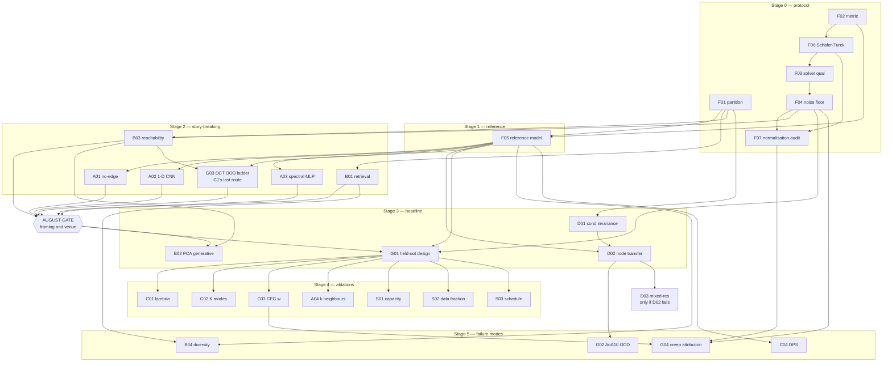

# Paper 1 — experiment register

Master table of all **29** experiments. One row per spec in [specs/](specs/).
Update `Status` as you go; this is the board.

Metric choices for each experiment are argued in [METRICS.md](METRICS.md); the
frozen definitions are in [PROTOCOL.md §2](PROTOCOL.md).

**Tier** — `gate` can invalidate the paper's framing, run first · `core` must
appear in the paper · `support` strengthens it, cut first if time runs out.

**Status** — `planned` → `ready` (config written) → `running` → `done` → `reported`
(results file written).

---

## 1. Master table

### F — Foundation & protocol → paper §3, §4.1

| ID | Title | Tier | Question | Depends | Train | Solver | Status |
|---|---|:--:|---|---|:--:|:--:|:--:|
| [P1-F01](specs/P1-F01_data-partition.md) | Data partition & leakage audit | **gate** | Is there a clean disjoint three-way split, and what did Year-1 actually evaluate on? | — | 0 | 0 | ✅ **[reported](results/P1-F01_data-partition.md)** — falsified |
| [P1-F02](specs/P1-F02_grading-metric.md) | Canonical grading metric | **gate** | Do the four existing (ρ, a) implementations agree? What is the single definition? | — | 0 | 0 | ✅ **[reported](results/P1-F02_grading-metric.md)** — falsified |
| [P1-F03](specs/P1-F03_solver-qualification.md) | Solver instrument qualification | **gate** | Is the solver fit to grade — accurate, stable, resolution-insensitive? | F02 | 0 | ~29 | ✅ **[reported](results/P1-F03_solver-qualification.md)** — ⚠️ marginal *(regraded 08-17; was falsified)* |
| [P1-F04](specs/P1-F04_noise-floor.md) | Grading noise floor | **gate** | What is the measurement uncertainty of ρ and a? | F02 F03 | 0 | 27 | ✅ **[reported](results/P1-F04_noise-floor.md)** — supported; **protocol frozen** |
| [P1-F05](specs/P1-F05_reference-model.md) | Reference model, clean protocol | **gate** | Does the EXP-022 recipe reproduce on a clean split, and what is its true held-out performance? | F01 (F02 for grading only) | 5 | 0 | ✅ **[reported](results/P1-F05_reference-model.md)** — supported; attempt 3 is P1-REF |
| [P1-F06](specs/P1-F06_schafer-turek.md) | **Schäfer–Turek absolute benchmark** | **gate** | Does the solver reproduce published `Cd`, `Cl`, Δp, St bounds — i.e. is it *absolutely* correct, not just self-consistent? | F02 | 0 | ~12 | ✅ **[reported](results/P1-F06_schafer-turek.md)** — 2D-1 complete; qualified for drag + pressure, not lift *(regraded 08-25; unchanged)* |
| [P1-F07](specs/P1-F07_normalisation-audit.md) | **Cp normalisation audit** — source of `a ≈ 1.74` | **gate** | Where does the affine magnitude factor come from? | F02 F04 F06 | 0 | 6 | ⚠️ **[reported](results/P1-F07_normalisation-audit.md)** — partial; factor of 2 sourced, **9.35% ± 0.91pp residual** |

### A — Architecture necessity → paper §4.2 (C1)

| ID | Title | Tier | Question | Depends | Train | Solver | Status |
|---|---|:--:|---|---|:--:|:--:|:--:|
| [P1-A01](specs/P1-A01_no-edge-control.md) | No-edge control | **gate** | Does message passing contribute anything? | F05 | 3 | ~12 | planned |
| [P1-A02](specs/P1-A02_cnn1d-ring.md) | 1-D circular CNN | **gate** | Is ring message-passing just a convolution? | F05 | 3 | ~12 | planned |
| [P1-A03](specs/P1-A03_spectral-mlp.md) | Spectral-coefficient MLP | **gate** | Does a spectral basis at matched DOF match per-node diffusion? *(the dropped EXP-013 Method E)* | F05 | 6 | ~12 | planned |
| [P1-A04](specs/P1-A04_receptive-field.md) | Receptive field on aero data | core | Does `k=6`, chosen on the circle benchmark, transfer? | F05 | 6 | ~12 | planned |

### B — Basis necessity → paper §4.3 (C1)

| ID | Title | Tier | Question | Depends | Train | Solver | Status |
|---|---|:--:|---|---|:--:|:--:|:--:|
| [P1-B01](specs/P1-B01_retrieval-baseline.md) | Nearest-neighbour retrieval | **gate** | Does generation beat a lookup table? | F01 F02 | 0 | 35 | 🟡 **[partial](results/P1-B01_retrieval-baseline.md)** — retrieval is **at the grading ceiling**; comparison awaits G01 |
| [P1-B02](specs/P1-B02_pca-generative.md) | Low-dim PCA generative baseline | **gate** | Does node-native reach designs a 10-mode basis cannot? | F05 B03 | 4 | ~16 | planned |
| [P1-B03](specs/P1-B03_basis-reachability.md) | Basis reachability analysis | core | How many modes cover this dataset to within the noise floor? | F01 F04 | 0 | ~8 | ✅ **[reported](results/P1-B03_basis-reachability.md)** — falsified; solver half done 08-25, **M=1 is inside the noise floor** |
| [P1-B04](specs/P1-B04_diversity-coverage.md) | Diversity & design-space coverage | core | Is this *exploration*, or one-to-one regression? | F05 B01 | 0 | ~40 | planned |

### D — Discretisation independence → paper §4.4 (C2)

| ID | Title | Tier | Question | Depends | Train | Solver | Status |
|---|---|:--:|---|---|:--:|:--:|:--:|
| [P1-D01](specs/P1-D01_conditioning-invariance.md) | Conditioning invariance under resampling | core | Is the DCT conditioning genuinely node-count independent? | F01 | 0 | 0 | ✅ **[reported](results/P1-D01_conditioning-invariance.md)** — falsified |
| [P1-D02](specs/P1-D02_node-count-transfer.md) | Node-count transfer at sampling time | **core** ★ | Can a 96-node-trained model generate at 48 and 192? | F05 D01 | 0 | ~60 | ready — P1-REF available |
| [P1-D03](specs/P1-D03_mixed-resolution.md) | Mixed-resolution training | conditional | If D02 fails, does training across node counts fix it? | D02 | 3 | ~20 | planned |

### C — Conditioning ablations → paper §4.5 (C2)

| ID | Title | Tier | Question | Depends | Train | Solver | Status |
|---|---|:--:|---|---|:--:|:--:|:--:|
| [P1-C01](specs/P1-C01_lambda-pressure.md) | `λ_pressure` — DeepSets head necessity | **core** | Does the auxiliary pressure head do anything? `λ=0` is the control | F05 | 8 | ~24 | planned |
| [P1-C02](specs/P1-C02_dct-modes.md) | DCT modes `K` | core | Is `K=8` justified? | F05 | 5 | ~20 | planned |
| [P1-C03](specs/P1-C03_cfg-weight.md) | Guidance weight `w` | core | Is `w=3.0` justified — and does guidance *cause* magnitude creep? | F05 | 0 | ~24 | planned |
| [P1-C04](specs/P1-C04_dps-guidance.md) | DPS guidance, clean protocol | core | Does the Year-1 negative result survive seeds and the noise floor? | F05 F04 | 0 | ~48 | planned |

### G — Generalisation & failure modes → paper §4.6 (C4)

| ID | Title | Tier | Question | Depends | Train | Solver | Status |
|---|---|:--:|---|---|:--:|:--:|:--:|
| [P1-G01](specs/P1-G01_holdout-inverse-design.md) | Held-out inverse design | **core** ★★ | How well does it hit targets it has never seen? **The headline.** | F05 F04 | 0 | ~100 | planned |
| [P1-G02](specs/P1-G02_aoa10-ood.md) | AoA10 physical OOD | core | Does it transfer to a genuinely different physical regime? | F05 D02 | 0 | ~24 | planned |
| [P1-G03](specs/P1-G03_dct-ood-ladder.md) | DCT-space OOD ladder | **gate** ⬆ | How does performance decay in the space the model is *conditioned* on? | F05 B03 | 0 | ~45 | ready — **promoted to gate 2026-08-26**: after B03 this is C1's only surviving route |
| [P1-G04](specs/P1-G04_creep-attribution.md) | Magnitude-creep attribution | **core** | Is the creep model-side, solver-side, or grading-side? | F04 C03 **F07** | 0 | ~24 | planned |

### S — Scale & data efficiency → paper §4.7

| ID | Title | Tier | Question | Depends | Train | Solver | Status |
|---|---|:--:|---|---|:--:|:--:|:--:|
| [P1-S01](specs/P1-S01_capacity.md) | Capacity sweep | support | Is 147k parameters the right size, and does it saturate? | F05 | 9 | ~12 | planned |
| [P1-S02](specs/P1-S02_data-fraction.md) | Data-fraction curve | **core** | How much data does this actually need? *(viva Part B3)* | F05 | 6 | ~24 | planned |
| [P1-S03](specs/P1-S03_diffusion-schedule.md) | Diffusion schedule justification | support | Are `T=1000` and the cosine schedule justified or inherited? | F05 | 6 | ~24 | planned |

---

## 2. Totals

| | Count | Serial wall-clock |
|---|:--:|---|
| Training runs | **~64** | ~91 h (85 min each, parallelises freely) |
| Solver runs | **~658** | ~22 h (median ~2 min each) |
| Analytic / no-compute | 5 experiments | days of coding, not compute |

**Training is ~4× the solver cost.** The bottleneck is run bookkeeping across ~64
training runs, not CFD queue time — build a sweep driver, not a CFD batch driver.

---

## 3. Dependency graph

**Read the graph for three things.** First, the **August gate** is fed only by cheap
experiments — nothing after it is worth running until the framing survives. Second,
`D02 → G02` matters: the AoA10 set has **80 nodes, not 96**, so it confounds
physical extrapolation with node-count extrapolation. Running D02 first is what
lets you attribute G02's degradation.

Third, the new chain **`F06 → F07 → G04`**. Every solver number in the Year-1
report is *relative* — graded by correlation against the dataset, which cannot
detect an error the two share, and an affine fit absorbs precisely the class of
error most likely present. F06 (Schäfer–Turek) is the first **absolute** check, and
it exists to answer one question before G04 needs it: is `a ≈ 1.74` a solver error
or a definitional constant? Attributing magnitude creep to the model is not
possible until the reference scale is known.

---

## 4. Coverage — every commitment is discharged

### Viva feedback

| Feedback | Discharged by |
|---|---|
| Additional baselines where methodology exceeds 2D need (B1.1) | **A01 A02 A03 B01 B02** |
| Justify/motivate methodological choices (B1.1) | **A04 C02 C03 S01 S03** |
| Contributions mirrored in experimental setup (B1.2) | Group ↔ contribution map, [README §2](README.md) |
| Ablations focused on the contributions (B1.2) | **C01 C02 C03 A04** |
| Hold-out set of appropriate size (B1.3) | **F01 F05 G01** — 20 random test targets × 5 seeds |
| Reconsider OOD construction w.r.t. the conditioning space (B1.3) | **G03** (DCT-space ladder), **G02** (real physical OOD) |
| *(self-identified)* Unexplained `a ≈ 1.74` carried through every result | **F06 F07** — open action item from EXP-040, never closed |
| *(self-identified)* All solver validation is relative, never absolute | **F06** — Schäfer–Turek published bounds |
| Variation in difficulty across principal components (B1.3) | **G03** — per-direction ladder, not a single scalar axis |
| Risk reflection & fall-backs (B3) | **S02** data-fraction curve; **D03** as a registered fall-back |
| Train/test split *(own note)* | **F01** |
| Motivate architecture *(own note)* | **A01 A02 A03 A04** |
| Highlight key contributions *(own note)* | [REPORT_OUTLINE.md](REPORT_OUTLINE.md) §1 |
| OOD in DCT not PCA space *(own note)* | **G03** |
| Scale study *(own note)* | **S01 S02** |

### Reviewer questions from [[../publication/PUBLICATION_PLAN]] §13

| # | Question | Answered by |
|:--:|---|---|
| 1 | Why a graph? Show a 1-D CNN | **A02** (+ A01, A03) |
| 2 | Why node-native? Show 10 PCA modes | **B02** (+ B03) |
| 3 | "Direct node movement" — nodes only move radially | Vocabulary discipline; deferred to Paper 2 |
| 4 | "Mesh-native" — this is a 96-node ring | Vocabulary discipline; deferred to Paper 3 |
| 5 | Were evaluation targets held out? | **F01 G01** |
| 6 | How does this beat nearest-neighbour retrieval? | **B01** |
| 7 | Does the DeepSets head contribute? Show λ=0 | **C01** |
| 8 | Show generation at a different node count | **D02** (+ D01) |
| 9 | Is the difference outside sampling noise? | **F04** + [PROTOCOL §6](PROTOCOL.md) |
| 10 | Show diversity and coverage | **B04** |

All ten are now assigned. Six of them were unanswerable in the Year-1 report.

Three further attacks, not on that list, are now also covered:

| Attack | Answered by |
|---|---|
| *"Your affine fit is a fudge factor absorbing a solver error."* | **F06** (absolute benchmark) + **F07** (localise the constant) |
| *"All these Cp curves look alike — what is ρ at chance?"* | **F04** companion analysis. Until this is computed, the headline ρ has no scale |
| *"Your OOD targets may be physically unrealisable."* | **G03** realisability screen + the achievability bound from **B01** |

---

## 5. What is deliberately *not* here

Registered as out of scope so it cannot creep in:

Cartesian free node movement · Re/H physical conditioning · CFD-in-the-loop
optimisation · closing the magnitude creep (Paper 1 **measures and attributes** it,
it does not fix it) · Hron–Turek · full grid-convergence study · aerofoil families ·
3D · volume meshes · variable topology.

All of these belong to Papers 2 and 3 — see [[../publication/RESEARCH_PROGRAMME]].
