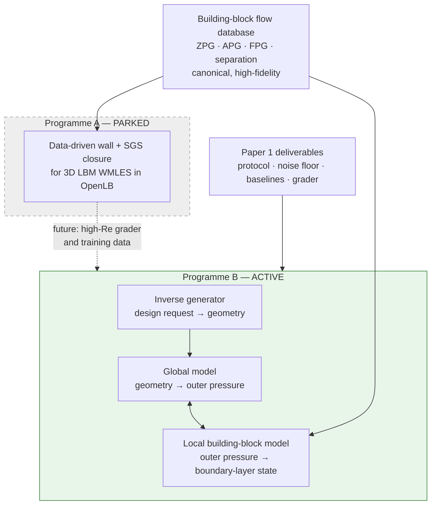
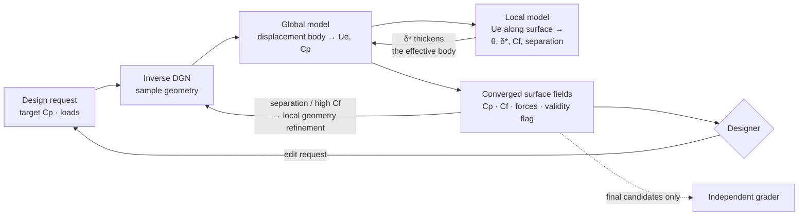
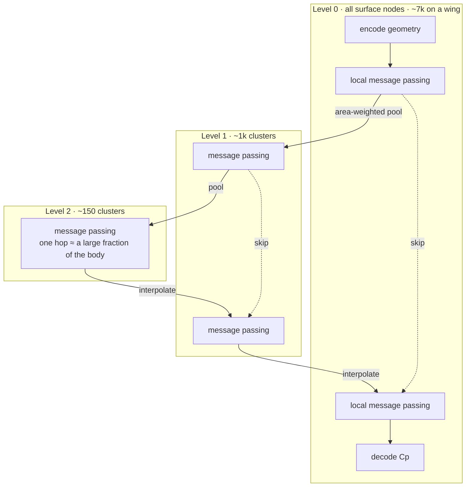
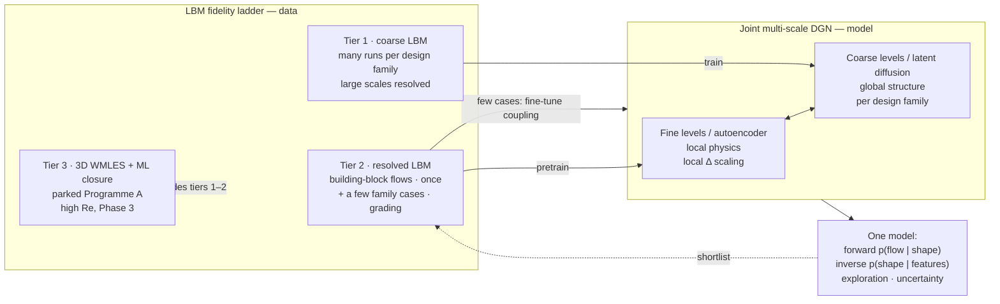

# Next phase — building-block design programme

> **Status: working brainstorm, not a plan.** Updated as the conversation moves.
> Decisions are logged in §8 with their date; everything else is open. When this
> settles it becomes a spec, and [[RESEARCH_PROGRAMME]] is revised to match.

---

## 1. Why a next phase

| What Paper 1 established | Evidence |
|---|---|
| The pipeline works end-to-end; conditioning steers the shape | [[../paper1/results/P1-G01_holdout-inverse-design\|G01]] §4a — shape-to-request correlation 0.97 |
| Target drag is matched inside the noise floor | G01 §4b — 1.08σ |
| Generation is node-count invariant | [[../paper1/results/P1-D02_node-count-transfer\|D02]] — 100% valid, 24–384 nodes |
| An independent, absolutely-qualified grader | F03 · F04 · F06 |
| **Not established: that a generative model is *needed*** | [[../paper1/results/P1-B03_basis-reachability\|B03]] one mode inside the noise floor · [[../paper1/results/P1-B01_retrieval-baseline\|B01]] retrieval at the grading ceiling · G01 loses to retrieval at 4.3σ |

The limitation is the design space, not the method. No two-parameter family can
demonstrate that generation beats lookup.

---

## 2. Two programmes — B active, A parked

Programme A is written up, with triggers for picking it back up, in
[[PARKED_A_LBM-WMLES-closure]].

---

## 3. Programme B — a multi-fidelity design loop

**The owner's framing (2026-09-17):** the global/local split *is* a multi-fidelity
design philosophy.

- **Global structure is hewn from low-fidelity runs.** Low-fidelity data is cheap
  and abundant, so the global model covers the design space widely. That is what
  makes exploration possible.
- **The local model refines**, first by providing the local flow features, then by
  driving local geometry changes.

**Classical ancestor — viscous–inviscid interaction (VII)**, as in XFOIL and MSES.
A panel method solves the outer flow, an integral boundary layer solves the inner
one, and the two are coupled through the displacement thickness `δ*`. The
integral-BL closure correlations are fitted to canonical profile families
(Falkner–Skan for laminar flow). **Those closures are a building-block model with
hand-fitted correlations.**

### 3.1 The local model is a feasibility constraint *during* exploration

An inviscid-only explorer will happily propose pressure distributions that no
real boundary layer survives. The classic case is a pressure recovery steeper than
the Stratford limit. So the local model cannot be run only at the end. It has to
be in the exploration loop as the check on *"can the boundary layer live with
this?"* That is where the building-block physics earns its place, and it is
cheap enough (§4.2) to run on every candidate.

---

## 4. The global model — how the split is enforced

### 4.1 Why the multi-scale bottleneck enforces the *wrong* split

**How a multi-scale graph network works** (MuS-GNN, [[linoFastSimulationEnvironmental2022]];
MultiScale MeshGraphNets, [[fortunatoMultiScaleMeshGraphNets2022]]):

Pressure is elliptic: every point feels the whole body. On a flat graph that
needs as many message-passing hops as the body is wide. At level 2 one hop spans
a large fraction of the body, so a few layers couple everything cheaply. That is
why multi-scale is the right *architecture* for the global model.

**The bottleneck version** restricts the global branch to the coarse levels, so it
can only output fields that are smooth at the coarse scale `ℓ_c`. A local branch
at level 0, with a receptive field `≤ ℓ_f`, adds residual detail. This is a split
by **tangential length scale**, like an LES filter.

**Why it does not separate viscous from inviscid:** VII's split is in the
**wall-normal** scale (`δ/L ≪ 1`), not the tangential one. The dominant viscous
effect on Cp is *smooth across the whole chord*. The displacement body moves the
effective trailing edge, the Kutta condition shifts, and the change in
circulation alters Cp everywhere: decambering, lost lift, a shallower lift-curve
slope. That signal is long-wavelength, so a coarse global branch absorbs it and
the local branch is left with nothing to do.

Where the tangential scale *does* line up with viscous physics: transition
ramps, laminar separation bubbles, separation lines, shock feet. Those are useful,
but they are not the main effect.

### 4.2 The displacement-body channel — the recommended split

Make `δ*` an explicit **input** to the global model, so the global model *is* an
inviscid solver about the displacement body `X + δ* n` (plus wake displacement).

| Training data for the global model | Source | Cost |
|---|---|---|
| Bodies with `δ* = 0` | Panel method on design-space geometries | Very cheap, unlimited |
| Bodies with synthetic smooth `δ*` fields | Panel method on artificially displaced bodies | Very cheap, unlimited |
| Real `(X, δ*, Cp)` triples | High-fidelity CFD, with `δ*` integrated from velocity profiles | Expensive; used for validation and coupled fine-tuning |

This resolves both sides of the panel-method argument:

- **"A panel-trained global model misses key physics."** It misses it *on its own*.
  In VII the viscous physics enters through `δ*`, supplied by the local model. The
  global model only has to be a good inviscid solver for arbitrary bodies, and
  panel data is exactly right for that.
- **Identifiability.** The global model *cannot* absorb viscous effects silently,
  because at `δ* = 0` it is anchored to inviscid ground truth. Viscous effects have
  only one way in: the local model.
- **Trust boundary.** The global model is trustworthy exactly as far as the
  displacement-body concept holds: thin layers and a thin wake. The local model
  can flag when that fails (separation extent, `δ*/L` growth, or a BFM-style
  nearest-training-sample confidence score).

**The question a reviewer will ask:** if the global model is trained on panel
data, why not just run the panel method? A learned global model has to justify
itself against the panel method it imitates: batched speed across thousands of
exploration samples, differentiability through the generator, an amortised
inverse. **The panel method is the global model's retrieval baseline.**

---

## 5. Enforcing local physics — the ladder

| Rung | Mechanism | Guarantee | Cost |
|---|---|---|---|
| 1 · Residual loss | Penalise the momentum-integral residual `dθ/ds + (2+H)(θ/Ue) dUe/ds − Cf/2`, with graph finite differences | **Soft**; weight-dependent | ~free |
| 2 · Conservative message passing | Antisymmetric edge fluxes `m_ij = −m_ji`, area-weighted node update | **Exact conservation form**, but the flux is learned, so the physics is not guaranteed | ~free; no solve, never fails to converge |
| 3 · Residual guidance at sampling | Gradient of the equation residual steers the sampler | Soft, inference-time only | One residual gradient per step |
| 4 · Solve the equations, learn only the closures | Local model **is** the integral BL equations on the surface graph; ML supplies `Cf`, `H*`, dissipation | **Exact, and the right equations** | A Newton solve per evaluation (§5.1) |

**Rung 2 is not soft**: it is exact, but it conserves a *learned* flux. It
guarantees the form of a conservation law, not its content. Rung 1 is the soft
one.

### 5.1 What rung 4 costs, and how gradients reach the networks

**Inference.**

| | Unknowns | Solve | Expected cost |
|---|---|---|---|
| 2D aerofoil | ~200 nodes × 3–4 | Dense Newton, ~5–15 iterations | XFOIL-class; well under a second, batched on GPU |
| 3D wing | ~10⁴ nodes × 4–5 | Sparse Newton, coupled to the global model | Seconds cold; **sub-second warm-started**, since a designer's edit is a small perturbation of a converged state |
| Closure network | — | Small MLP per node | Negligible (BFM's own finding) |

**Training — two stages, mirroring BFM's lesson:**

1. **A priori:** fit the closure MLP directly to building-block data
   (`H, Re_θ,` pressure-gradient parameter `→ Cf, H*, C_D`). Supervised, minutes,
   no solver involved.
2. **A posteriori:** put the closure inside the solver and fine-tune on the
   *converged* coupled state. Gradients come by **implicit differentiation**: at
   convergence `R(u, θ) = 0`, so `dL/dθ = −(∂L/∂u)(∂R/∂u)⁻¹(∂R/∂θ)`. That is one
   adjoint linear solve reusing the Newton Jacobian, roughly 1.5–3× a forward
   solve. (Unrolling the iterations and backpropagating also works, with memory
   growing with iteration count.)

**What the gradient feeds.** The converged coupled state is differentiable with
respect to the closure parameters, the global-model parameters and the
**geometry**. So:

- the global model can be trained *through* the coupled solve against
  high-fidelity surface data;
- the inverse generator can be *guided through the whole coupled system*. This is
  the mechanism for "the local model refines the geometry" (§3).

**Rung 4 risks.**

- Newton fails near separation (the Goldstein singularity), so a strong or inverse
  coupling formulation is required. Non-converged samples must be masked out of
  training.
- The closure network must be smooth (SiLU, not ReLU), or Newton stalls.
- A 3D integral-BL implementation is **months** of work; 2D is **weeks**, and the
  formulation is thoroughly documented.

**Recommended staging:** build a rung 1+2 black-box local model first. It is fast
to build and practical, and **it becomes the ablation baseline for rung 4**. *"Does
solving the equations beat a conservative black box trained on the same building
blocks?"* is exactly the necessity experiment Paper 1 taught us to pre-register.

---

## 6. Generality — streamlined first, bluff as the extension

**The general philosophy:** *global large scales from cheap, abundant,
lower-fidelity models, plus local building-block closures from high-fidelity
canonical flows.* That is not tied to streamlined bodies.

**The instantiation *is* tied to them.** Surface-only VII works because thin-layer
asymptotics collapses the volume problem onto the surface, and `δ*` carries
everything the outer flow needs to know.

| | Streamlined, attached / mildly separated | Bluff, massively separated |
|---|---|---|
| Layer thickness | `δ/L ≪ 1` | Wake width ~ body size |
| What sets surface pressure | Body shape + displacement body | Base pressure set by wake dynamics: shedding, entrainment, recirculation |
| Where that information lives | On the surface | **Off the surface, in the volume** |
| Coupling variable | `δ*` | A wake / free-shear-layer representation |
| Global model lives on | The surface graph | **A coarse volume graph** covering the wake |
| Steady or distributional | Mostly steady | Unsteady, so Lino's *distributional* DGN matters most here |

**For bluff bodies the global model has to move into the volume.** Once it does,
"coarse volume model + local building-block closure" is the LES/BFM split itself,
with a learned large-scale solver. **Streamlined VII is the thin-layer limit of
that general structure.** Two consequences:

- The general philosophy can be stated at thesis level. The first claim should be
  made where it is sharp, on streamlined bodies, and bluff-body generality claimed
  only once it is shown.
- The bluff-body extension re-connects with both parked Programme A and the old
  Paper 3 "interior nodes / mesh-native" plan.

Note that Paper 1's ellipse case (laminar shedding at Re ≈ 750) is itself a
*bluff* flow, the wrong class for surface-only VII.

---

## 7. Design rules carried from Paper 1

1. **Pick a design space where retrieval and a few PCA modes fail, and verify it
   before building**, with B01/B03-style analysis on the candidate data.
2. **Every learned component has a classical baseline it must beat.** Retrieval
   for the generator; **the panel method for the global model**; **XFOIL / MSES
   for the coupled system**; the rung 1+2 black box for rung 4.
3. **The surrogate screens, the solver grades** ([[RESEARCH_PROGRAMME]] risk R6).
   The coupled model never grades its own output.
4. **Noise floor before claims; seeds budgeted up front.** P1-REF seed CV was 49%.
5. **Node spacing is a live variable** (D02). Unstructured 3D meshes make it worse.

---

## 7a. Is designing to Cp useful — or should it be exploration plus GP?

**The worry, stated fairly.** Cp is not the objective; drag, lift and stall margin
are. A designer can ask for a Cp that no shape achieves, or that no boundary layer
survives. And Paper 1 showed Cp *matching* cannot discriminate designs: unrelated
shapes correlate at 0.9954.

**Why intent-based design is still justified:**

- **It is established practice, not a novelty.** Inverse design from a specified
  pressure distribution is how many real sections were designed: Liebeck high-lift
  aerofoils, Eppler's method, the XFOIL/MSES inverse modes, NASA's CDISC for wings.
  Designers specify pressure because it *encodes intent in physical terms* —
  laminar extent, recovery shape, suction peak, loading.
- **Objective-only optimisation has a known failure.** Point-optimised aerofoils
  exploit weaknesses in the analysis and degrade off-design (Drela, *Pros and cons
  of airfoil optimization*, 1998 — to add to the library). A generative prior
  trained on sensible designs is a defence against this, and it is testable: the
  **exploitation gap** (claim C2 in [[NEXT_PHASE_PITCH]]).

**Resolution — don't choose.**

- Condition the generator on **aerodynamic features**, not a full Cp curve. The
  separation margin and transition location are features only the local model can
  supply, which ties the building blocks into the design language.
- One model then serves three modes:
  - **objective** mode — BO or gradient search over the features;
  - **intent** mode — partial specification, using classifier-free guidance's
    condition dropout, already in the Paper 1 code;
  - **expert** mode — a full Cp target.
- **Judge every mode by outcomes** (`Cd`, `Cl`, stall margin, off-design
  robustness) graded by the high-fidelity solver — never by Cp match.

**Where GP sits.**

- **Baseline:** GP-BO over a CST parameterisation with the high-fidelity solver is
  the standard sample-efficient optimiser. **Multi-fidelity GP** (panel/XFOIL
  low-fidelity, high-fidelity on top) is the *honest* competitor to the whole
  multi-fidelity story, and must be in the baseline set. If it matches the tool on
  high-fidelity calls per task, the deep-learning half is not justified.
- **Possible component:** BO over the generator's low-dimensional feature space,
  with the coupled surrogate as the cheap evaluator. GP then complements the
  generator rather than competing with it.
- **The decisive comparison is amortisation.** GP-BO pays per task. The tool pays
  once for building blocks and training, then a few high-fidelity calls per task.
  Report the break-even number of tasks.

### 7b. Where the "less training data" claim actually comes from

- **Building-block data is family-independent.** It is paid for once and reused
  for every design family.
- **The global model is trained on panel data.** High-fidelity cost: zero.
- **The generator is trained on surrogate-labelled designs.** High-fidelity cost:
  zero. Risk: it inherits the surrogate's bias, so it has to be measured by the
  exploitation gap.
- **"Fine-tuning on a few cases" is the a posteriori stage of §5.1**, applied per
  family. The closures stay physics; only the residual family-specific behaviour
  is calibrated — transition, trailing-edge and wake effects, regime gaps.
- **So the high-fidelity budget per new family is the fine-tuning cases plus
  grading.** Claim C1 measures this against a black-box surrogate that needs
  high-fidelity data for everything.

---

## 7c. Critique (owner, 2026-09-17) — the plan drifted away from the DGN

> *"How am I justifying this as the natural progression to my DGN work? Are there
> more logical approaches that better use the DGN framework? And the panel method
> is a lower-accuracy version of the LBM + WMLES closure I envisioned."*

**Both points stand.** §3–§5 followed the physics logic one step at a time:
identifiability → displacement body → integral boundary layer. The end state:

- the core contribution is a learned viscous–inviscid hybrid, a CFD /
  reduced-order-modelling thesis;
- the graph diffusion model is a peripheral generator;
- the LBM investment — grader, protocol, hand-written solver — is replaced by a
  1980s method.

That does not follow from Paper 1.

**One nuance on accuracy.** Panel plus integral BL is not *uniformly* worse.
XFOIL-class tools are accurate and cheap for attached flow over streamlined
bodies. LES-class physics earns its cost at separation, stall, low-Re laminar
bubbles, unsteady wakes and 3D junctions. So the fidelity has to match the design
question. For a DGN + LBM thesis, though, **LBM is the physics engine, and
panel/XFOIL belong in the baseline set only.**

### 7c.1 The natural-progression chain

| Paper 1 finding | What it demands next | Element of the re-based route |
|---|---|---|
| Graph diffusion generates valid shapes and steers from conditioning; node-count invariant (G01 §4a, D02) | Keep the DGN at the centre, and scale it | Joint shape–flow DGN on richer geometry |
| One mode suffices; retrieval wins (B03, B01, G01) | A design space where generation is actually needed | Richer families (aerofoils, then 3D) |
| **~5,700 simulations to cover a two-parameter family** | High-fidelity data per family does not scale to real design spaces | **Building blocks: learn transferable local physics once** |
| DPS guidance from a separately-trained pressure head degrades OOD (EXP-042) | Don't bolt a separate learned physics head onto the generator | Flow channels *inside* the joint diffusion. *(Hypothesis: removes the head mismatch; OOD reliability still has to be tested)* |
| The model reads aspect ratio from template **spacing** (D02) | Geometry must enter through invariant local descriptors | BFM-style local non-dimensionalisation by local `Δ` |
| Independent LBM grader qualified (F03–F07) | Keep LBM as physics engine and referee | An **LBM fidelity ladder** |
| Lino's DGN is forward, `p(Cp \| shape)`; Paper 1 is inverse, `p(shape \| Cp)` | Unify | `p(shape, flow)` |

### 7c.2 DGN-native routes

| Route | Mechanism | Uses DGN | Uses LBM | Building blocks | Risk / prior art |
|---|---|---|---|---|---|
| **R1 · Joint DGN** | One diffusion over geometry + flow channels. Forward, inverse and exploration are all conditioning or inpainting | Centrally | Data + grader | Not intrinsic | Data-hungry per family. Prior art: DiffusionPDE (joint coefficient–solution, grid-based) |
| **R2 · Building-block-pretrained local levels** | Multi-scale DGN: fine levels pretrained on canonical LBM flows, coarse levels trained per family | Centrally | Data + grader | **Centrally** | Does learned locality transfer? Unproven for pretraining a denoiser |
| **R3 · Compositional** | Separate diffusion models per block, composed at sampling by summing energies | Centrally | Data + grader | As composed models | **CinDM** (ICLR 2024) does this for multi-airfoil design, with *geometric* sub-systems |
| **R4 · Closure-first** | Un-park A as the main line; DGN as a generative near-wall closure inside coarse LBM | As closure | Centrally | Centrally | Most CFD; slowest route to design results |

### 7c.3 Proposed re-base — "the multi-scale graph *is* the fidelity hierarchy" (R1 + R2 on an LBM ladder)

**In Lino's LDGN terms:** LDGN already splits into a graph autoencoder (fine →
coarse latent) and a diffusion model on the coarse latent graph. The autoencoder
learns *local* structure, so it is the natural place for building-block
pretraining. The latent diffusion learns the *global* distribution per family. The
building-block idea slots into the DGN's own architecture rather than beside it.

**Why the split is identifiable this time:** coarse-LBM data physically cannot
contain resolved near-wall structure, because the grid does not resolve it. The
data resolution enforces the split, and on a volume or near-wall graph the scale
split includes the wall-normal direction. This is the §4.1 objection answered.

**Regime consequence:** 2D LBM without a turbulence closure means **low Re**
(laminar separation, bubbles, shedding). That is a real design domain — small
UAVs, small wind turbines — where XFOIL-class tools are weakest and Lino's
distributional DGN matters, because the flow is unsteady. High-Re 3D arrives with
tier 3, which is exactly parked A's un-park trigger.

### 7c.4 What survives from the earlier decisions

| Earlier decision | Under the re-base |
|---|---|
| Programme B philosophy — global/local, multi-fidelity, building blocks | **Survives** |
| Panel method as the global model's data | **Replaced** by coarse LBM; panel/XFOIL become baselines only |
| Integral BL, physics rung 4 | **Dropped** from the main line. Physics comes from LBM data, rung 2 (conservative GN edges) and rung 3 (residual guidance — cf. DiffusionPDE) |
| Streamlined first (§6) | **Reopened.** LBM data does not need thin layers; the scoping variable becomes the Re regime |
| 2D → swept wing → 3D | Survives. The swept wing becomes a 3D-LBM stepping stone rather than a crossflow-IBL one |
| Claims C1–C3 | **Survive unchanged.** The idea was right; the machinery was wrong |
| Feature conditioning, three design modes (§7a) | Survives |
| Programme A parked | Still parked, now with a defined slot as tier 3 |

### 7c.5 Must-read before Gate G0

- **CinDM** — Wu et al., *Compositional Generative Inverse Design*, ICLR 2024.
  Diffusion models of sub-systems composed to design multi-airfoil systems more
  complex than the training data. Closest prior art to "building blocks +
  diffusion + aerodynamic inverse design". Check its representation and flow
  regime.
- **DiffusionPDE** — Huang et al., NeurIPS 2024. Joint distribution of
  coefficients and solutions; forward and inverse under sparse observation;
  PDE-residual guidance.
- **AirfoilGen** — arXiv 2605.20303 (2026). Latent diffusion for aerofoil
  generation, valid by construction.
- **Novelty has to sit in:** building blocks as *flow regimes* learned as *local
  graph operators* (not geometric components); discretisation-native graphs; the
  LBM fidelity ladder; independent grading.

---

## 8. Decision log

| Date | Decision | Basis |
|---|---|---|
| 2026-09-17 | Paper 1's dataset is exhausted for modelling claims | B01 · B03 · G01 |
| 2026-09-17 | Building blocks = **local flow regimes coupled by a learned global model** (Programme B) | Owner's choice |
| 2026-09-17 | BFM-style 3D LBM WMLES closure **parked** as Programme A, written up with un-park triggers | Owner's choice; [[PARKED_A_LBM-WMLES-closure]] |
| 2026-09-17 | Programme B framed as **multi-fidelity**: global from low-fidelity data, local refinement from building blocks | Owner's framing |
| 2026-09-17 | *Provisional:* streamlined lifting bodies first; bluff bodies as the extension that moves the global model into the volume | Leaning; §6 |
| 2026-09-17 | **Staging: 2D aerofoils → infinite swept wing → 3D wings** | Owner's choice |
| 2026-09-17 | Framed as a **design-space exploration tool**, justified by inverse design, differentiability and speed, and data efficiency via building blocks; GP-based methods among the baselines | Owner's framing; §7a |
| 2026-09-17 | Pitch, flowchart and plan drafted in [[NEXT_PHASE_PITCH]] | Superseded by the critique below |
| 2026-09-17 | **Critique accepted:** the panel/IBL instantiation drifted from the DGN and discarded the LBM investment. Pitch under revision; DGN-native re-base proposed (§7c) | Owner critique |
| 2026-09-18 | **Route chosen: joint multi-scale DGN with building-block pretraining on the LBM ladder.** Work proceeds in four parts: idea → implementation plan → experiments and success conditions → road to publication (multiple papers expected) | Owner's choice |
| 2026-09-18 | Part 1 drafted in [[NEXT_PHASE_CONCEPT]]. The building blocks move from the autoencoder (§7c.3) to a **local refiner conditioned on the coarse state** (cascade). Reason: pretraining an autoencoder buys a compression; BFM's premise is a mapping | Awaiting owner review |

---

## 9. Open questions

- [x] ~~Which route to re-base on?~~ → joint multi-scale DGN + building blocks on the LBM ladder
- [ ] **Review Part 1 ([[NEXT_PHASE_CONCEPT]]) — especially the cascade vs single-LDGN framing** *(current)*
- [ ] Review the claims C1–C3 under the chosen route
- [ ] Fate of Paper 1's remaining 19 experiments — needed to fix Phase 0
- [x] ~~2D aerofoils first, or straight to 3D wings?~~ → 2D, then swept, then 3D
- [ ] Global model: displacement-body channel (§4.2), or another split?
- [ ] Physics rung: confirm the rung 1+2 baseline, then rung 4 (§5)?
- [x] ~~What does the designer specify?~~ → aerodynamic features, in three modes (§7a) — pending review
- [ ] Interim high-Re grader: LBM-RANS ([[ponsinEnhancedWallBoundary2026]]), finite-volume RANS, or an external dataset?
- [ ] Where do the building-block data come from, and at what Re?
- [ ] Transition: fully turbulent (tripped) boundary layers first, or a transition model from the start?
- [ ] Literature check (Gate G0): learned closures for integral boundary-layer methods; differentiable VII; physics-constrained graph networks; 3D integral BL formulations; feature-conditioned generative aerofoil design; multi-fidelity BO for aerofoils
- [ ] Aerofoil shape representation: radial `r(θ)` cannot represent aerofoils reliably; normal-offset from a template ([[RESEARCH_PROGRAMME]] R2.1, rung 1) is the likely route
