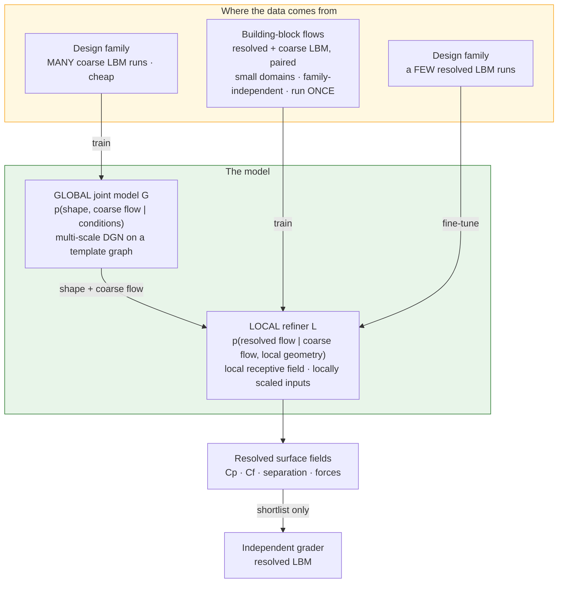
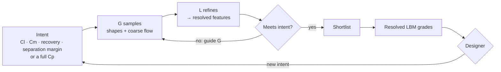

# Next phase — the idea, explained

> **Part 1 of 4.** Part 1: the idea (this note). Part 2: the implementation plan.
> Part 3: experiments and success conditions. Part 4: the road to publication.
> The reasoning trail that led here is [[NEXT_PHASE_BRAINSTORM]] (§7c for the
> DGN-native re-base).
> *Structured notes, not prose.*

---

## 0. In one breath

**Separate what is universal from what is specific.**

- *Universal:* how the flow next to a wall responds to pressure gradients,
  curvature and separation. It can be learned **once**, from simple canonical flows.
- *Specific:* how a particular body shapes the flow around it. It varies with each
  design family, but **coarse, cheap simulations capture it well**.

A two-level graph diffusion model mirrors that split:

- a **global** model, trained on many cheap coarse-LBM runs, generates *shape and
  coarse flow together* — the design and exploration engine;
- a **local refiner**, trained on high-fidelity **building-block flows**, restores
  the near-wall physics the coarse runs miss.

---

## 1. The problem it answers

Paper 1 needed **~5,700 simulations to cover a two-parameter family**, and a
nearest-neighbour lookup still matched the model. Any realistic design space has
more dimensions, and high-fidelity data per family grows with them. **Covering a
design family with high-fidelity CFD does not scale.**

So the question for the next phase is:

> *How does a generative design model get physics it can **transfer** — so a new
> design family costs a handful of high-fidelity runs, not thousands?*

---

## 2. Two observations the idea rests on

### 2.1 Coarse grids get the large scales right

This is the premise of LES: a coarse grid resolves the large, energetic, geometry-
driven motions; what it misses is small-scale and — near a wall — **local**.

Coarse is also *much* cheaper. LBM cost grows as `N³` in 2D (`N²` cells × `N` time
steps at fixed Mach) and as `N⁴` in 3D. So coarsening by 4× costs about **64× less
in 2D and 256× less in 3D**. The lever gets stronger exactly where it is needed
most.

### 2.2 The building-block premise (Lozano-Durán's BFM)

> *"The physics of the missing scales in complex scenarios can be locally mapped
> onto the small scales of simpler flows."* — Arranz et al. 2024

BFM makes this work by keeping the model's inputs **local** and **locally scaled**
— by the viscosity `ν` and the local grid size `Δ` — so the model cannot tell a
channel flow from an aircraft wing, only a local flow state. It is trained on
channel and Poiseuille–Couette flows, and it works on the NASA CRM high-lift
aircraft.

**Put together:** coarse runs supply the *specific, global* part cheaply. Building
blocks supply the *universal, local* part once. A model built this way should need
very little high-fidelity data per design family.

---

## 3. The design — a two-level cascade

### 3.1 The global joint model `G`

- **What it models:** the *joint* distribution of a shape and its coarse flow,
  `p(shape, coarse flow)`, optionally given conditions (Re, angle of attack).
- **Representation:** a template surface graph. The shape is a diffused node
  feature — a normal offset from the template, which generalises Paper 1's radius
  `r(θ)` and escapes star-convexity. The flow channels sit on the same nodes.
- **Architecture:** Lino's multi-scale DGN, extended so that geometry channels are
  generated rather than given.
- **Trained on:** many coarse-LBM runs of the design family.
- **Why joint:** one model, three jobs, chosen by what is fixed and what is sampled:

  | Mode | Fixed | Sampled | Ancestor |
  |---|---|---|---|
  | Forward | shape | flow | Lino's DGN |
  | Inverse | aerodynamic features | shape (+ flow) | Paper 1 |
  | Exploration | some features, or nothing | everything else | — |

### 3.2 The local refiner `L`

- **What it models:** `p(resolved flow | coarse flow, local geometry)` — the missing
  near-wall physics, *given* the large-scale state.
- **Inputs per surface node, BFM-style:**
  - local geometry (curvature × `Δ`);
  - coarse surface pressure;
  - a short stack of coarse wall-parallel velocity samples at a few wall distances
    (BFM's `u∥` input).
  
  All non-dimensionalised by local scales. No volume graph needed.
- **Receptive field:** deliberately *local* — a few message-passing hops. It cannot
  see the whole body, so it can only learn things that transfer.
- **Why a diffusion model, not a regression:** the missing small scales are not
  determined by the coarse state. They have a *distribution* (Lino's point, made at
  the closure level).
- **Trained on:** paired coarse/resolved building-block flows, run once and reused
  for every family, then fine-tuned on a few resolved runs of the family.
- **Two ways to feed it:**
  - from `G`, fully learned, in milliseconds; or
  - from an actual coarse-LBM run, physics-backed, in seconds to minutes.

  The second makes `L` a **post-hoc learned closure for coarse LBM** — the bridge
  to parked Programme A.

### 3.3 This is your multi-fidelity loop

> *"The global structure can be hewn out of lower fidelity runs … then the local
> model can help refine the geometry through first providing the local flow
> features."* — owner, 2026-09-17

- `G` explores and designs at coarse fidelity.
- `L` supplies the local flow features.
- Geometry is refined by guiding `G` with features computed through `L`.

---

## 4. A correction to the previous step

§7c.3 of the brainstorm put the building blocks in the **LDGN's autoencoder**. On a
closer reading of Lino et al., that buys a *compression*: a good autoencoder
represents any field, physical or not. BFM's premise is about a **mapping** — from
the resolved state to the missing scales. A mapping is physics; a compression is
not.

So the building blocks belong in a **refinement stage conditioned on the coarse
state**. In LDGN terms, that is the decoder conditioned on coarse-LBM fields,
trained as its own diffusion model.

This is the same coarse/fine split, with the building blocks put where they carry
physics. It also matches **cascaded diffusion** in image generation (Ho et al.,
JMLR 2022): a base model at low resolution, then super-resolution stages. Here the
super-resolution stage is the closure.

---

## 5. Where the physics enters

| Source | How |
|---|---|
| **LBM data** | Every training sample is a Navier–Stokes solution, coarse or resolved |
| **Locality + local scaling** | `L` sees only local, locally-scaled inputs — the BFM lesson. This also targets D02's spacing sensitivity |
| **Consistency constraint** | Filtering `L`'s output back to the coarse grid must return the coarse input. `L` may add small scales, not rewrite large ones — which makes the global/local split *structural*. It is only safe if assumption H1 holds (§7), so it could be hard or soft |
| **Conservative message passing** | Antisymmetric edge fluxes in the graph blocks (brainstorm §5, rung 2) |
| **Residual guidance** | Equation residuals steer sampling (rung 3; cf. DiffusionPDE) — optional |

---

## 6. How a design session runs

- **Conditioning on resolved-physics features** (such as separation margin): label
  `G`'s coarse training set by running `L` over it — cheap — so `G` learns to
  condition on refined features directly.
- **Speed:**
  - `G` + `L` on a surface graph is sub-second per sample with a few-step sampler
    (Lino used 50 denoising steps).
  - The coarse-LBM path is seconds to minutes.
  - The resolved grader is only for the shortlist.

---

## 7. What it assumes — and how each assumption is checked early

| # | Assumption | If false | Early, cheap check |
|---|---|---|---|
| **H1** | The fidelity gap (resolved − coarse) is **predominantly local** | A one-way refiner cannot fix global errors (e.g. a wrong separation point moving the circulation); `G` and `L` must be coupled two-way | Run the same bodies at two resolutions. Decompose the difference by length scale; measure how much a local-receptive-field regressor explains |
| **H2** | The local map **transfers** from building blocks to design bodies | No data saving — C1 fails, and it is the headline | Train `L` on blocks only; test on held-out bodies against a family-trained `L` |
| **H3** | Coarse LBM is **stable and cheap enough**: a meaningful cost ratio at a resolution that still gets the large scales right | The global tier is not cheap, and the multi-fidelity lever disappears | Measure the stability envelope and cost ratio. **Known constraint:** Paper 1's BGK case needs `RES ≥ ~100` and blows up below it. The coarse tier needs a more robust collision operator (regularised / MRT, both in OpenLB) |
| **H4** | The design space is **rich enough** that retrieval and a few PCA modes fail | Paper 1 again | B01/B03-style analysis on the candidate family, before building |

**H2 is the idea.** If building-block training does not transfer, what is left is
a competent multi-fidelity surrogate — useful, but not this thesis.

---

## 8. Relation to prior work

| Work | What is borrowed | What is new here |
|---|---|---|
| Lino et al. 2025 (DGN / LDGN) | Multi-scale graph diffusion; distributional flow states; the fine/coarse split | Geometry generated *jointly*; the coarse level trained on coarse *physics*, not a learned latent; a transferable refiner |
| Arranz / Lozano-Durán 2024 (BFM) | Building-block premise; local, locally-scaled inputs; numerically consistent training data (paired coarse/resolved runs in the *same* solver) | Used as a *generative, post-hoc* refiner in a design model, not an in-solver closure |
| Paper 1 | Graph diffusion inverse design; feature conditioning; discretisation invariance; the independent LBM grading protocol | — |
| Cascaded diffusion (Ho et al. 2022) | Base model + super-resolution stages | The super-resolution stage is a physics closure trained on *different geometries* |
| CinDM (Wu et al. 2024) | Diffusion-based inverse design that generalises beyond training geometry | Blocks are **flow regimes as local operators**, not geometric sub-systems composed at sampling |
| DiffusionPDE (Huang et al. 2024) | Joint distribution for forward + inverse; residual guidance | Graph-based, multi-fidelity, building-block refiner |
| Diffusion flow-field super-resolution (in the library) | Diffusion as super-resolution for flow fields | Refiner trained on canonical flows and applied to unseen bodies |

---

## 9. Deliberately *not* in the first version

- Volume or near-wall shell nodes — the off-wall probe stack stands in for them.
- 3D, high Re, and WMLES (tier 3 = parked Programme A).
- Instantaneous-state distributions. Version 1 targets **time-averaged** fields;
  Lino-style distributional sampling comes later.
- Compositional sampling across blocks.
- Two-way `G`↔`L` coupling — only if H1 fails.

---

## 10. Design decisions for Part 2

| # | Decision | Recommendation |
|---|---|---|
| D1 | Time-averaged fields or instantaneous-state distributions? | Time-averaged first |
| D2 | Surface graph + off-wall probe stack, or shell nodes? | Probe stack |
| D3 | Consistency constraint hard or soft? | Decide after H1 is measured |
| D4 | Phase 1 design family and shape source | Low-Re aerofoils. Shape source to decide (NACA families, UIUC set) |
| D5 | Coarse-tier collision operator and resolution envelope | Measure (H3) |
| D6 | Reynolds range for 2D | ~10³ – few × 10³, subject to the H3 cost measurements |
