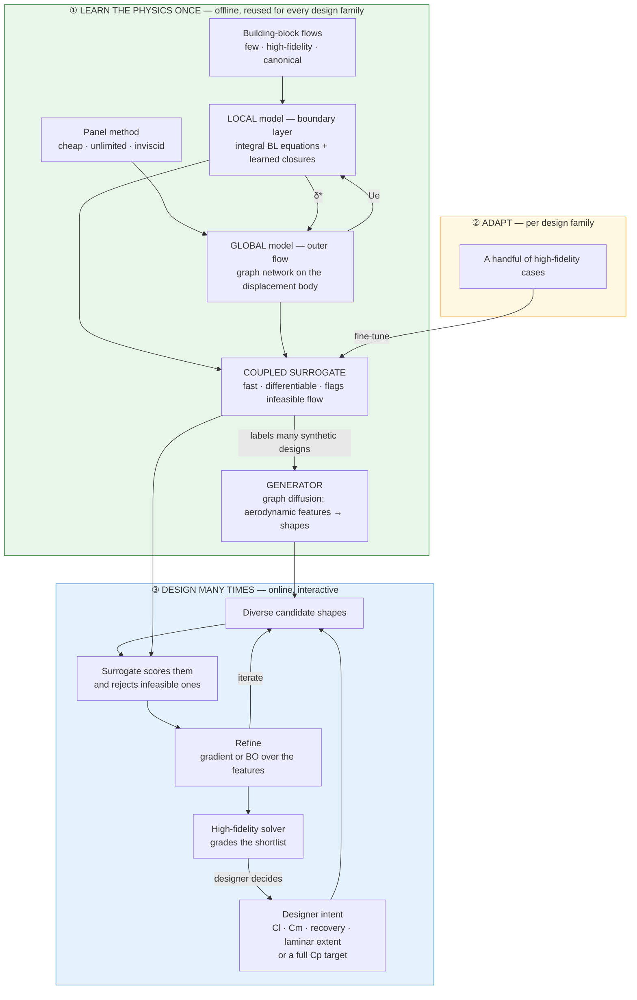
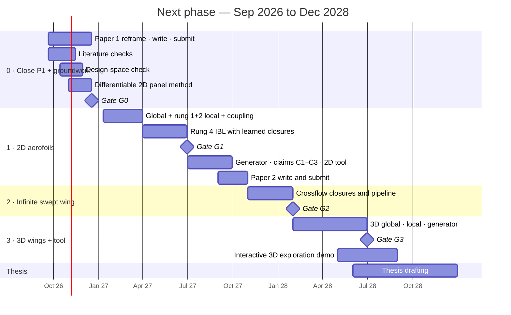

# Next phase — the pitch

> [!warning] Under revision (2026-09-17)
> The panel-method / integral-BL machinery in §1 and §3 drifted away from the DGN
> and discarded the LBM investment. A DGN-native re-base is proposed in
> [[NEXT_PHASE_BRAINSTORM]] §7c. Claims C1–C3 (§5) and the conditioning stance
> (§4) survive; §1, §3 and §6 will be rewritten once a route is chosen.

> One page: the idea, how it fits together, and the plan to completion. The
> reasoning behind every line is in [[NEXT_PHASE_BRAINSTORM]].
> *Structure, not prose — reword in your own voice before any of it goes into a
> report or paper.*

---

## 1. The idea

**Learn the physics once, design many times.**

A design tool whose fast surrogate is split the way aerodynamics splits:
- a **global** outer flow, learned from cheap panel-method solutions;
- a **local** boundary layer, whose closures are learned from a small library of
  high-fidelity **building-block flows**.

That surrogate sits inside a **graph diffusion generator** that turns designer
intent into diverse, viscous-feasible geometries. It adapts to a new design family
from **a handful** of high-fidelity cases.

---

## 2. Need and gap

| Existing approach | Strength | What it lacks |
|---|---|---|
| High-fidelity CFD | Trustworthy | Hours per design, so exploration covers tens of designs |
| ML surrogates | Milliseconds | Thousands of high-fidelity runs *per design family*; fail outside it |
| Panel + integral BL (XFOIL, MSES) | Transfers across families; fast | Hand-fitted closures; mostly 2D, attached flow |
| Optimisers (GP-BO, adjoint) | Sample-efficient for one question | Nothing is reused for the next target; point optima exploit model error |

**Gap:** no tool is at once **fast enough to be interactive**, **transferable to a
new design family with little high-fidelity data**, and **generative** — mapping
intent to diverse, physically feasible designs.

**Why it should work:**

| Ingredient | Evidence it is plausible |
|---|---|
| Global/local split | Thin-layer asymptotics; decades of viscous–inviscid interaction |
| Closures learned from simple flows transfer to complex bodies | BFM — trained on channel flows, predicts an aircraft |
| Graph diffusion steers shape from conditioning, independent of discretisation | Paper 1 — G01 §4a, D02 |

---

## 3. How it fits together

**In words:**
1. **Once:** building blocks teach the boundary layer, and panel solutions teach
   the outer flow. The two are coupled into a fast, differentiable surrogate, and
   that surrogate labels enough designs to train the generator.
2. **Per family:** a few high-fidelity cases fine-tune the coupled system.
3. **Every design task:** intent goes in. The generator proposes, the surrogate
   filters and refines, and the high-fidelity solver grades the shortlist.

---

## 4. What the generator is conditioned on — and why that is justified

- **Not a Cp curve to be matched. Aerodynamic *features*** — the language
  designers already use for intent:

  | Feature | Design meaning |
  |---|---|
  | `Cl`, `Cm` | Loading, trim |
  | Suction-peak magnitude and location | Stall behaviour |
  | Pressure-recovery gradient | Separation margin |
  | Favourable-gradient extent | Laminar flow, friction drag |
  | Separation margin, transition location | **Only the local model can supply these** |

- **Three modes, one model:**
  - *objective* mode: BO or gradient search over the features to minimise `Cd`;
  - *intent* mode: specify some features, leave the rest free;
  - *expert* mode: a full Cp target — the classical inverse-design practice.

- **Justified by outcomes, never by Cp match.** Designs are judged on `Cd`, `Cl`,
  stall margin and off-design robustness, graded by the high-fidelity solver.
  (Paper 1: Cp correlation between *unrelated* shapes is 0.9954 — Cp match cannot
  discriminate.)

---

## 5. The claims

Each claim is falsifiable, and each has a baseline that could make the method
unnecessary.

| # | Claim | Measured as | Baseline it must beat |
|---|---|---|---|
| **C1** | Building blocks cut the high-fidelity data needed | Data-scaling curve on an **unseen** design family | Black-box graph surrogate trained on high-fidelity data only |
| **C2** | The generative prior makes exploration trustworthy | **Exploitation gap** (surrogate-predicted vs HF-graded performance of chosen designs); viscous-feasibility rate | Direct gradient optimisation on the same surrogate; inviscid-only exploration |
| **C3** | The tool amortises across design tasks | High-fidelity calls per design task; break-even number of tasks | GP-BO on CST parameters; **multi-fidelity GP** (panel/XFOIL + HF); XFOIL inverse design |

Component baselines: **the panel method** for the global model, **XFOIL** for the
coupled surrogate, and **retrieval** for the generator.

---

## 6. The plan to completion

| Gate | When | Question | If no |
|---|---|---|---|
| **G0** | Dec 2026 | Is the combination still open in the literature? Is the aerofoil design task non-trivial for retrieval and GP? Are building-block data and a high-fidelity grader secured? | Re-scope before building anything |
| **G1** | Jun 2027 | Does the coupled surrogate reach XFOIL-class accuracy against high-fidelity data on attached flow, and does rung 4 converge robustly? | Carry the rung 1+2 learned local model forward; rung 4 becomes future work |
| **G2** | Jan 2028 | Do crossflow closures hold on the swept wing? | 3D uses the rung 1+2 local model |
| **G3** | Jun 2028 | Is full 3D on track for the thesis? | 3D becomes a demonstration chapter; the swept wing carries the 3D-physics claim |

| Output | Content | Target |
|---|---|---|
| Paper 1 | *Pending decision* — evaluation protocol plus the honest negative result | Dec 2026 |
| Paper 2 | 2D physics-structured generative design: C1–C3 | Oct 2027 |
| Paper 3 / chapter | Swept and 3D wings, interactive exploration tool | 2028 |

**Assumption to confirm:** thesis drafting from mid-2028, carried over from
[[RESEARCH_PROGRAMME]] §7.
