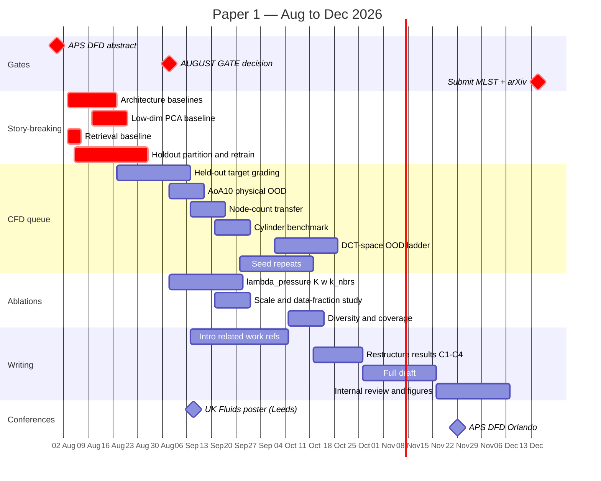

# Paper 1 — publication readiness assessment

**Assessment date:** 2026-07-29 · **Horizon:** Aug–Oct 2026 · **Basis:** `DGN_Docs/report/year1_report.md`, EXP-001→043, `src/`, `cfd/`, Year-1 viva feedback.
**Revision:** reframed around **node-native generative design** as the primary contribution, with LBM demoted to evaluation instrument. See §2 for my assessment of that reframing — **it is right in direction but currently overclaimed, and it changes which experiment is most urgent.**

Written in the voice of an unsympathetic first-round reviewer. The work is genuinely good; the point is to find the attacks before a reviewer does.

---

## 1. The reframing, as requested

### Contribution hierarchy

| # | Contribution | Role | Evidence status |
|---|---|---|---|
| **C1** | **Node-native generative shape design** — diffusion over a per-node field on the boundary graph, with no hand-designed low-dimensional parameterisation | **Primary** | 🔴 Asserted, never tested against any alternative |
| **C2** | **Resolution-independent physics conditioning** — DCT + DeepSets, node-count-independent by construction | Supporting | 🟡 Argued; independence never demonstrated |
| **C3** | **Independent LBM examiner** — grading by first-principles physics, not a self-trained surrogate | **Instrument** | 🟢 Strong (15-case gate) |
| **C4** | **Failure taxonomy enabled by C3** — OOD decay, model-side magnitude creep, DPS counterproductivity | Payoff | 🟢/🟡 Well-evidenced |

This is the right *intellectual* ordering. The representation is the thesis-level contribution; LBM is a measuring instrument that happens to have been expensive to build. Demoting C3 to instrument is correct and I agree with it.

### Working title

> **"Node-native generative design: graph diffusion over boundary discretisations for aerodynamic inverse design, graded by an independent lattice-Boltzmann solver."**

### The narrative

Conventional generative aerodynamic design operates in a **hand-designed low-dimensional parameterisation** — CST/Bézier/PARSEC coefficients, PCA modes, or a learned latent. That parameterisation bounds the reachable design space *a priori*: whatever the basis cannot express, the model cannot propose. This work instead generates **at the level of the discretisation itself** — one diffused degree of freedom per boundary node — so the design space is limited by mesh resolution rather than by a basis chosen in advance. Physics conditioning is applied in a fixed-size spectral space so it stays decoupled from node count. An independent lattice-Boltzmann solver then grades the result, which is what makes the evaluation trustworthy enough to expose where the approach fails.

That is a real, defensible, interesting claim. **But it is not the claim your words describe, and it is not yet supported.**

---

## 2. ⚠️ Feedback: where the reframing is wrong

You asked me to say if this is wrong. Two parts of it are, on the evidence in this repository.

### 2.1 "Direct node movement" is not what the model does

Every config in `configs/` — all eleven — uses `feature_mode: radial_norm` with `output_dim: 1`. The node feature is **a single scalar**, `x = [r/r̄]`. The configs' own comments state it plainly:

```yaml
input_dim: 3             # [r/r̄, cos θ, sin θ] — r is noised, position is fixed context
output_dim: 1            # predict noise for r channel only
```

So nodes do **not** move freely. They move **radially only, along fixed rays from the centroid, on a frozen angular parameterisation**. `[cos θ, sin θ]` is fixed context, never diffused. That is **1 DOF per node**, not 2.

A reviewer reading "direct node movement using diffusion" and then finding a radial scalar field will conclude you have overclaimed — and they will be right. Worse, radial-from-centroid is *itself* a shape parameterisation: it cannot represent non-star-convex boundaries at all. You have not escaped parameterisation; you have chosen a high-dimensional one.

**`feature_mode="cartesian"` exists** in the dataset class (`x = [x_norm, y_norm]`, 2 DOF per node) — that genuinely *is* direct node movement. It has **never been trained**. EXP-012 was planned as "Method B — Cartesian (x,y) direct" and its config uses `radial_norm` (it became per-node Cp concatenation instead). Consistent with [[shape-method-representation-history]]: no Cartesian shape experiment has ever run.

### 2.2 "Mesh-native" is not supported either

The graph is a **boundary ring of surface nodes** — no interior nodes, no volume mesh, fixed ring topology.

> ⚠️ **Corrected 2026-08-03 by [[../paper1/results/P1-F01_data-partition]].** This section previously claimed *"every sample in `pOnEllipseTrain.h5` has exactly 96 nodes, so the model has never seen a different node count"* and concluded resolution independence was untested. **That is wrong.** The corpus spans **52–96 nodes across 12 distinct values**; the HDF5 array is merely padded to its 96-node maximum, and only **37 of 5701** samples actually have 96 (the mode is 60). The model has been trained across discretisations from the beginning.
>
> The overclaim verdict on "mesh-native" still stands — a boundary ring is not a volume mesh. But the *resolution* half of the criticism is withdrawn: variable node count is in-distribution, which is direct support for C2 and was available all along. See also §5.1, which is superseded on the same point.

"Mesh-native" invites a reviewer to expect volume-mesh generation or resolution transfer. You have a fixed-length boundary ring. Call it what it is: **boundary-discretisation-native**.

### 2.3 The consequence that actually matters

Here is the uncomfortable part, and it is the reason this reframing is riskier than the previous one:

> With a **fixed, ordered, 96-node ring** carrying **one scalar per node**, `r(θ)` **is a 1-D periodic signal of fixed length 96**. A graph network with ring edges over that is, functionally, a 1-D convolution with extra machinery.

So the obvious reviewer question becomes the central one: **does the graph earn its place at all?** A 1-D CNN, or an MLP over DCT/Fourier coefficients of `r(θ)`, is the natural baseline — and on a fixed-length ordered signal it may well match you at a fraction of the complexity.

This question **was planned and then silently dropped**. From `EXPERIMENT_PLAN.md`:

> **EXP-013: Method E — Fourier coefficient MLP.** *"Is the GN graph architecture necessary, or does K=16 Fourier coefficient diffusion (MLP) match graph quality?"*

EXP-013 became smoothness regularisation on `radial_norm`. The experiment that tests your new headline contribution **does not exist** — and it is the one the viva panel was pointing at with *"additional baselines in places where the methodology is more complex than immediately needed for the 2D case."* They were asking exactly this. Under the old framing that was a fair criticism. Under the new framing it is existential.

### 2.4 Net judgement

| Aspect of the reframing | Verdict |
|---|---|
| LBM is an instrument, not the contribution | ✅ **Right.** Agree fully |
| The representation is the intellectual contribution | ✅ **Right** — and the better thesis story |
| OOD needs re-evaluating | ✅ **Right** — and easier under this framing (§5.2) |
| Findings C4 stay as the payoff | ✅ **Right** |
| "Direct node movement" | ❌ **Overclaimed** — radial 1-DOF. Rescope, or train Cartesian |
| "Mesh-native" | ❌ **Overclaimed** — fixed 96-node boundary ring |
| Graph diffusion is the contribution | ⚠️ **Untested.** The one experiment that would show it was dropped |

**Bottom line:** the reframing is right in direction and wrong in its current wording — and it is a *bigger* overclaim than the holdout problem I flagged last time, because it puts the burden of proof on experiments that do not exist rather than on ones that were run imperfectly. It also **shifts the critical experiment**: the Fourier-MLP/1D-CNN baseline is now blocker #1, ahead of the retrieval baseline.

**Recommendation — adopt the framing, rescope the wording:**

| Instead of | Say |
|---|---|
| "direct node movement" | "a per-node diffused shape field" — or train Cartesian and earn the phrase |
| "mesh-native" | "boundary-discretisation-native" |
| "graph diffusion is the contribution" | "generation at discretisation level without a hand-designed low-dimensional basis" — then *prove* the graph with the ablation |

Every one of those is still a strong claim. All three are true today.

---

## 3. What I verified

- Reproduced the split (`GraphDataLoader`, seed 42, `val_split=0.1`, 5701 → 5131/570) and checked target membership.
- `feature_mode` and `output_dim` across all 11 configs: **uniformly `radial_norm` / `output_dim: 1`**.
- Boundary node count in `pOnEllipseTrain.h5`: **fixed at 96**.
- `ScoreNetwork` parameters from `EXP-022_T1000.yaml`: **147,585**.
- `data/ellipse/raw/` vs `DatasetUrl` enum ([pOnEllipse.py:76-91](src/graph_diffusion/data/pOnEllipse.py#L76-L91)).
- Inventoried `cfd/ellipse2d/runs/` (86 runs), `outputs/sweep_results/`.

---

## 4. 🔴 RED — blockers

Ordered by urgency **under the new framing**. Items 4.1–4.2 are new; 4.3–4.5 carry over.

### 4.1 ★★ The graph architecture is untested — now blocker #1

*(Viva point 1, and the dropped EXP-013 Method E)*

You cannot headline "graph diffusion for node-native design" with zero non-graph comparators. Required, all at matched parameter count and matched DOF:

| Baseline | Question |
|---|---|
| **MLP over DCT/Fourier coefficients of `r(θ)`** | Does a spectral parameterisation match the graph? *(the dropped EXP-013)* |
| **1-D CNN over the 96-node ring** | Is ring message-passing just a convolution? |
| **Per-node MLP, no edges** (`GraphNetworkBlock` with EdgeModel disabled) | Does message-passing contribute anything? |

The third is nearly free — the architecture already makes each sub-model optional (see `building_blocks/`), so it is a config change.

**If the graph loses to a 1-D CNN, the framing must change again.** Better to know in week two. **Effort:** ~2 weeks. **Do this first.**

### 4.2 ★★ No low-dimensional-parameterisation baseline

C1's entire premise is that a hand-designed low-dim basis *limits* the design space. Untested. Required: generate in a conventional basis at matched DOF — PCA modes over the training shapes (cheapest, the machinery in `data/cp_manifold.py` already does Cp-PCA and ports directly to shape-PCA), or CST/Bézier.

The claim to establish: node-native reaches shapes the low-dim basis cannot, *and* those extra shapes are physically useful. If a 10-mode PCA basis matches 96 node-DOF on every metric, C1 is dead and this is the experiment that says so. **Effort:** ~1.5 weeks.

### 4.3 ★ The headline in-distribution result is measured on training data

Unchanged from the previous assessment, still a blocker. `scripts/export_generated_for_openlb.py:163` calls `pick_targets_farthest_first()` over the **full** dataset (built with `split: train`) and never sees the loader's split:

| Target | Report claim | Actual |
|---|---|---|
| sim #4849 (Re 960) | ρ = 0.964 "in-distribution" | **TRAIN — seen** |
| sim #4066 (Re 884) | ρ = 0.966 "in-distribution" | **TRAIN — seen** |

n=2, and farthest-first selected, so they are the most extremal points rather than a random sample.

*The 15-case `eval_grid` gate (§4.3 of the report) is unaffected — those runs push dataset shapes through the solver with the model uninvolved.*

**Fix:** `pOnEllipseTest.h5` exists upstream ([pOnEllipse.py:80](src/graph_diffusion/data/pOnEllipse.py#L80)) and **has never been downloaded**; `split="test"` is already plumbed. Retrain with a clean 3-way partition; CFD-grade **15–20 randomly-sampled held-out** targets. **Effort:** ~2–3 weeks with queue time.

### 4.4 ★ Nearest-neighbour retrieval baseline

Still required, now blocker #2 rather than #1. The design space is effectively 2D (Re, `b`) with 5701 training sims, so *"return the training shape whose Cp is closest in DCT space"* may match you in-distribution. Different question from §4.1: that one asks *does the graph earn its place*, this one asks *does generation beat a lookup table*. Both cheap, both necessary. **Effort:** ~3 days.

### 4.5 ★ Ablations still do not test the contributions

*(Viva point 2)* On the aero dataset, graded by solver-measured ρ on **held-out** targets:

| Ablation | Question | Lever |
|---|---|---|
| `λ_pressure` ∈ {0, 0.01, 0.1, 1.0} | **Does the DeepSets head do anything?** λ=0 is the key control | `model.lambda_pressure` |
| `K` ∈ {3, 5, 8, 16, 32} | Is K=8 justified? | `k_modes` |
| CFG weight `w` ∈ {0, 1, 3, 5, 7} | w=3.0 is unjustified | `sampling.guidance_scale` |
| `k_neighbors` on aero data | The k=6 choice rests on the *circle* benchmark | `k_neighbors` |

The last one is promoted under this framing: receptive field is now a claim about the representation, not an incidental setting. **Effort:** ~2–3 weeks; training is cheap at 147k params, CFD grading is the cost.

---

## 5. 🟡 YELLOW — polish and small extra results

### 5.1 ★ C2's resolution independence — partly already evidenced *(revised)*
> ⚠️ **Superseded 2026-08-03.** The premise "the model has only ever seen 96 nodes" is false — training spans **52–96 nodes over 12 values**. C2 already has in-range evidence.

The remaining question is *extrapolation*: sample at `N ∈ {40, 52, …, 192}` and CFD-grade, reporting **in-range and out-of-range separately** since they test different claims. A free real-data check exists: `pOnEllipseThick.h5` contains samples at **100 nodes**, above the training maximum. Still the highest value-per-hour item, and now a sharper experiment. See [[../paper1/specs/P1-D02_node-count-transfer]]. **Effort:** ~1 week.

### 5.2 OOD re-evaluation — easier under this framing
Currently only `+PC1` reaches genuine OOD, because raw-curve PCA σ-units are not isometric to DCT space *(viva note: "OOD in DCT space not PCA space" — the panel spotted this independently)*. Re-parameterise the ladder in DCT-conditioning space for a monotone, isotropic distance axis.

Under the new framing OOD gets a **second, sharper meaning worth exploiting**: not just *out-of-distribution targets*, but *out-of-reach-of-a-low-dim-basis shapes*. That reframes the OOD ladder as a direct test of C1 rather than a generic robustness check. **Effort:** ~1–2 weeks.

### 5.3 ★ A free, physically-genuine OOD set is unused
`data/ellipse/raw/pOnEllipseAoA10.h5` — 24 sims at 10° AoA, Re 500–1000 — is already local and **never used**; `variant="aoa10"` is already supported. Real CFD data, asymmetric and lifting, wholly outside the symmetric-ellipse training manifold. Answers the viva's *"reconsider the construction of OOD samples"* far better than synthetic perturbations, which invite *"you built your own OOD set."*

Note the honest constraint: these have **80 nodes**, not 96 — which makes them a combined node-count *and* physics extrapolation test. That is a feature for §5.1, but state the confound. **Effort:** ~1 week.

### 5.4 No error bars anywhere
Every number is single-seed. The OOD ladder is itself described as *"noisier than monotonic,"* so the ρ 0.92 → 0.86 decay cannot currently be distinguished from sampling noise — and that decay is a headline claim. 3–5 seeds, mean ± CI. **Effort:** ~1 week.

### 5.5 Design-space *exploration* is unmeasured
The title now promises exploration; nothing measures it. Needed: sample diversity at fixed target (the one-to-many fibre that §3.1 argues for and never demonstrates), and design-space coverage versus the low-dim baseline of §4.2. Without these, "exploration" is decoration. **Effort:** ~1 week.

### 5.6 Scale study
*(Own viva note.)* At 147k params, cheap. Sweep depth × width × **training-set fraction** — the data-fraction curve speaks directly to the panel's Part B3 concern about *"the dependency between shape complexity and training data size"* and doubles as the risk analysis they asked for. **Effort:** ~1 week.

### 5.7 Justification of choices, and writing
T=1000, cosine schedule, 4 layers, `clamp_range`, w=3.0 each need a sentence of motivation or a citation. §1/§2/§6 are stubs; `refs.bib` has **13 entries** and needs ~35–40 — and under this framing the gap is now in **geometric deep learning, mesh-based generative models, and shape parameterisation for optimisation**, not just CFD surrogates. **Effort:** ~3 weeks, overlappable with compute.

---

## 6. 🟢 GREEN — nearly ready

- **The LBM examiner (C3, report §4.3).** 15-case (Re,H) grid, ρ = 0.96 mean, `a` = 1.74 stable across the plane, all runs stable, `a` independently matching the dataset's documented ~1.8 normalisation. **Note the framing dividend:** as an *instrument* this needs to be demonstrably fit for purpose, not publication-grade CFD in its own right — so the grid-convergence bar drops from mandatory to advisable, provided you target an ML-for-engineering venue (§8). Keep the cylinder benchmark; drop Hron–Turek to Paper 2. *Polish:* full 15-case table into an appendix.
- **Magnitude-creep localisation (C4).** Grading real and generated shapes through the *same* solver with resolution and node-density controls is well-designed logic. *Polish:* seeds.
- **DPS negative result (C4).** Fixed seed, single variable, monotone across four weights, mechanistically explained. *Polish:* seed repeats — the one green item with a real caveat.
- **Methodology and figures.** Publication-quality PDFs already in `DGN_Docs/report/figures/`.
- **Reproducibility infrastructure.** Strict mypy, tests, YAML configs, one-way dependency DAG. Cheap credibility; few papers here can claim it honestly.

---

## 7. 🔵 CUT / DEMOTE

- **Report §4.1 (circle k-sweep)** — single-seed, wrong domain, non-standard metric (radius KS). **But** its subject (receptive field) is now contribution-relevant, so *redo it on aero data* (§4.5) rather than cutting outright.
- **Report §4.2 (roughness/T sweep)** — cut the six-row table; keep one paragraph of the conclusion (smoothness is a sampling-time property; the wobble proved cosmetic under independent grading). Move detail to the thesis.
- **Hron–Turek** — defer. The cylinder benchmark suffices for an instrument.

---

## 8. Where to send it — the framing changes this

Journals are **rolling submission; there are no windows.** Only review latency matters. Windows apply to conferences (§9).

**The reframing shifts the venue.** Under the old framing (independent CFD validation of a generative model), Physics of Fluids was ideal — fluids-first audience, direct lineage to Lino et al. Under the new framing the contribution is **representational**, the fluids are the test-bed, and the audience that cares is ML-for-engineering / design optimisation. A fluids journal will ask why the fluid dynamics is so simple; a design/ML venue will not.

| Venue                                                  | Fit under new framing                                                                                     | Latency | Notes                                                                  |
| ------------------------------------------------------ | --------------------------------------------------------------------------------------------------------- | ------- | ---------------------------------------------------------------------- |
| **Machine Learning: Sci. & Tech.** (IOP)               | ★ **Best fit.** Representation contribution + honest evaluation + negative results                        | ~2–3 mo | Open access. Will demand the §4.1 architecture baselines               |
| **Struct. & Multidisc. Optimization**                  | ★ Strong — "design space exploration" is its remit; parameterisation-vs-node-native is a live topic there | ~3–4 mo | Will demand the §4.2 low-dim baseline                                  |
| **Computer Methods in Applied Mech. & Eng.**           | Strong but demanding                                                                                      | ~4–6 mo | Realistic once §4.1/§4.2 land well                                     |
| **Journal of Computational Physics**                   | Good — numerics-literate ML audience                                                                      | ~4–6 mo | Higher bar on the solver                                               |
| **Physics of Fluids**                                  | ↓ **Demoted.** Still viable, but the fluids are now incidental                                            | ~1–3 mo | Best fallback if the ML baselines disappoint and C3/C4 carry the paper |
| **Computer-Aided Design / Engineering with Computers** | Reasonable for the geometry angle                                                                         | ~3–4 mo | Niche                                                                  |
| **JFM**                                                | ✗ Not for this paper                                                                                      | ~6+ mo  | —                                                                      |

**Recommendation:** **MLST primary, SMO alternate.** Keep Physics of Fluids as the fallback — if §4.1 shows the graph does *not* beat a 1-D CNN, the representational claim collapses and you retreat to the validation-harness paper, for which PoF was already the right home. **Decide the venue after §4.1 and §4.2 report, not before.**

**Preprint:** arXiv on submission day — `cs.LG` primary, cross-list `physics.flu-dyn` (note the swap; it follows the framing).

---

## 9. Conferences

| Venue | Date | Deadline | Status |
|---|---|---|---|
| **APS DFD 2026**, Orlando | Nov 2026 | **31 Jul 2026, 5pm ET** | 🔥 **2 days** — abstract only (~250 words), APS membership required |
| **UK Fluids 2026**, Leeds | 8–10 Sep 2026 | Oral closed; **posters open** | ✅ Submit a poster |
| AIAA SciTech 2027 | Jan 2027 | 21 May 2026 | ❌ Missed → target SciTech 2028 (~May 2027) |
| NeurIPS ML4PS workshop | Dec 2026 | ~Sep 2026 (unconfirmed) | 🟡 **Now a better fit than before** — 4 pages on node-native design |
| ECCOMAS / WCCM | 2027+ | Varies | 🟡 Good for Paper 2 |

**On APS DFD:** abstract-only, no results locked, meeting in November when the new results will exist. Deadline is Friday — write it against the reframed story. One caution: APS DFD is a *fluids* audience, so pitch the LBM examiner and the physics findings (C3/C4) there, not the representation argument. The framing you present is audience-dependent; that is legitimate.

**On UK Fluids (Leeds, Sept):** take the poster. Six weeks out, forces the reframed narrative into one visual, and gets feedback from the community that will review you.

You presented at **DSFD 2026** in June. Note that deck's *"LBM as teacher and examiner"* framing is closer to the correct instrument-level role than the Year-1 report is — reuse it for C3.

---

## 10. How much work is Paper 1, really?

You framed P1 as *"little novel work, more a focus on refining the argument."* **Broadly right, with one correction worth internalising.**

Nothing in the P1 list is novel *research*. Training a 1-D CNN on a 96-length signal, fitting a shape-PCA basis, or running a k-NN lookup are standard comparative controls — days of routine work each, not new science. All the genuinely novel work sits in P2 and P3. So the *intellectual* load is indeed argument-refinement.

But "little novel work" ≠ "little work". Sorting the P1 backlog by what actually consumes time:

| Work type | Items | Effort | Constraint |
|---|---|---|---|
| **Argument & writing** | Reframe §1, rescope claims, contribution statement, cut/demote §4.1–4.2, restructure results C1→C4, §1/§2/§6, `refs.bib` → ~35–40 | ~3 weeks | Your time only |
| **Cheap compute** | Architecture baselines, PCA basis, retrieval, holdout retrain, 4 ablation sweeps, scale study, seeds, diversity metrics | ~2–3 weeks | Trivial at 147k params; parallelisable |
| **CFD grading** | Held-out targets (~18), AoA10 (~24), node-count transfer (~6), DCT-OOD ladder (~16), cylinder benchmark (~4), seed repeats (~30) | **~100 solver runs** | ⚠️ **The critical path** |

> ⚠️ **Corrected 2026-08-02 — the CFD-critical-path claim above is wrong.** Measured from this repository: one training run is **~85 min** (`outputs/EXP-022_T1000.log`), one solver run is **7 s – 14 min**, median ~1–3 min across 71 timed runs. The full pre-registered suite in [[../paper1/EXPERIMENT_REGISTER]] needs ~640 solver runs (**6× the estimate above**) but only ~21 h of solver time, against ~64 training runs and ~91 h. **Training is ~4× the solver cost.** The schedule driver is training runs × seeds, and the risk is bookkeeping across ~64 runs, not queue time — so the throughput fix is a **training sweep driver**, not a CFD batch driver. The table's *relative ordering* of work types stands; its constraint column does not.

**Practical consequence (unchanged):** front-load the CFD-independent work (architecture baselines, retrieval, PCA — none of which need the solver for a first verdict on the August gate). The solver queue can run underneath without ever becoming the constraint.

**The suite that supersedes this section:** [[../paper1/README]] — 27 pre-registered experiments, hypothesis and decision rule fixed before running. The §12 todo below remains a valid summary of *what* must happen; the specs are the *how*.

---

## 11. Paper 1 — timeline



---

## 12. Paper 1 — actionable todo

Ordered by execution, not by importance. **Bold** = story-breaking; do not write the paper before these report.

### Week 0 — by Fri 31 Jul
- [ ] **APS DFD abstract** (~250 words). Pitch **C3/C4** — fluids audience, not the representation argument.
- [ ] Download `pOnEllipseTest.h5`; wire `split="test"` end to end and confirm it loads.
- [ ] Write a batch run-manifest driver for the CFD queue (extend `run_from_manifest.sh`) — this is the throughput fix for §10.

### August — test the headline *(no solver needed for the verdict)*
- [ ] **Architecture baselines**, matched params and DOF:
  - [ ] MLP over DCT/Fourier coefficients of `r(θ)` — *the dropped EXP-013 Method E*
  - [ ] 1-D CNN over the 96-node ring
  - [ ] No-edge control — disable `EdgeModel` in `GraphNetworkBlock` (config change only)
- [ ] **Shape-PCA low-dim baseline** at matched DOF (~10 modes). Reuse the PCA machinery in `data/cp_manifold.py`.
- [ ] **Nearest-neighbour retrieval baseline** — closest training Cp in DCT space, in-distribution *and* OOD.
- [ ] **Clean 3-way partition; retrain the EXP-022 recipe.** Record split sizes explicitly.
- [ ] Start the CFD queue on 15–20 **randomly-sampled** held-out targets (not farthest-first).
- [ ] 🚦 **AUGUST GATE:** does the graph beat the 1-D CNN? Does node-native beat ~10 PCA modes? **If no to either → revert to the validation-harness framing and PoF.** Log the decision in [[PUBLICATION_DIARY]].

### September — underwrite the contributions
- [ ] **Node-count transfer**: train at 96, sample at 48/96/192, CFD-grade. ← *best value-per-hour in the plan*
- [ ] **AoA10 physical OOD** (24 sims, `variant="aoa10"`). Declare the 80-vs-96-node confound.
- [ ] Ablations on aero data, solver-graded on held-out targets: `λ_pressure` ∈ {0, 0.01, 0.1, 1.0} ← *λ=0 is the key control*; `K` ∈ {3,5,8,16,32}; `w` ∈ {0,1,3,5,7}; `k_neighbors`.
- [ ] Seed repeats (3–5) on the OOD ladder and DPS sweep → mean ± CI everywhere.
- [ ] Scale study; make the **data-fraction curve** the headline panel *(feeds P3 and viva Part B3)*.
- [ ] Cylinder benchmark — Cd and Strouhal vs literature. Instrument fitness, not full grid convergence.
- [ ] **UK Fluids poster**, Leeds, 8–10 Sep.
- [ ] Draft §1/§2; expand `refs.bib` toward geometric deep learning, mesh-based generative models, shape parameterisation for optimisation.

### October — complete and write
- [ ] DCT-space OOD ladder, framed as *reach beyond a low-dim basis*.
- [ ] Diversity and coverage metrics — makes "exploration" measurable.
- [ ] Cut §4.1/§4.2 tables to thesis; keep the one-paragraph smoothness conclusion.
- [ ] Restructure results as C1 → C2 → C3 → C4.
- [ ] Full draft → internal review → figure pass.
- [ ] Name P3.2 explicitly as where the representational advantage is *expected*, rather than overclaiming it on ellipses.

### November–December
- [ ] **Submit: MLST (alt SMO; fallback PoF) + arXiv (`cs.LG`, cross-list `physics.flu-dyn`).**
- [ ] APS DFD, Orlando.

### Stretch — only if August goes well
- [ ] **Train `feature_mode="cartesian"`.** Would make "direct node movement" literally true. Treat as a *research risk*, not a chore — rigid-motion ambiguity and self-intersection are genuine open problems (see [[RESEARCH_PROGRAMME]] §3). If it slips, it is P2's opening, which is where it belongs.

### Explicitly deferred
Re/H conditioning · CFD-in-the-loop optimisation · closing the magnitude creep · Hron–Turek · full grid convergence · aerofoils · 3D · volume meshes.

---

## 13. The series

Full three-paper arc, dependency graph, future research, risk register, and the *is-it-worth-publishing* assessment: **[[RESEARCH_PROGRAMME]]**.

| Paper | Earns | Window |
|---|---|---|
| **1. Node-native design** | *"discretisation-native"* | Aug–Dec 2026 |
| **2. Free node movement + closing the loop** | *"direct node movement"* | Q1–Q3 2027 |
| **3. Genuinely mesh-native** | *"mesh-native"* | Q4 2027+ |

Each paper buys one word of the claim you eventually want, on evidence gathered for that word alone. Progress tracked in [[PUBLICATION_DIARY]].

---

## 12. Viva feedback → coverage map

| Feedback | Where | Status |
|---|---|---|
| Additional baselines where methodology exceeds 2D need | **§4.1, §4.2** | 🔴 **Now central** |
| Contributions mirrored in experimental setup | **§1, §4.1, §4.5** | 🔴 |
| Ablations targeting the contributions | **§4.5** | 🔴 |
| Hold-out set of appropriate size | **§4.3** | 🔴 |
| Justify/motivate methodological choices | §5.7 | 🟡 |
| Reconsider OOD construction w.r.t. conditioning space | §5.2, §5.3 | 🟡 |
| OOD in DCT not PCA space *(own note)* | §5.2 | 🟡 |
| Train/test split *(own note)* | **§4.3** | 🔴 |
| Better motivate architecture *(own note)* | **§4.1** | 🔴 **Reframing makes this primary** |
| Highlight key contributions *(own note)* | §1 | 🟡 Addressed by the reframing |
| Scale study *(own note)* | §5.6 | 🟡 |
| Risk reflection / fall-backs (Part B3) | §5.6, §10 stretch | 🟡 |

The reframing **raises the stakes on viva point 1** — "better motivate the choice of architecture" moves from a polish item to the paper's load-bearing question. The panel was pointing at this. They may have seen it before you did.

---

## 13. Reviewer questions you cannot currently answer

Roughly in the order a reviewer will reach them, under the new framing:

1. *"Why a graph? Show me a 1-D CNN on the same 96-node ring."* — **doesn't exist.** §4.1
2. *"Why node-native? Show me 10 PCA modes at matched DOF."* — **doesn't exist.** §4.2
3. *"You say 'direct node movement' — your nodes only move radially."* — **correct, overclaim.** §2.1
4. *"You say 'mesh-native' — this is a 96-node ring with fixed topology."* — **correct, overclaim.** §2.2
5. *"Were your evaluation targets held out?"* — **no.** §4.3
6. *"How does this beat retrieving the nearest training shape?"* — **unknown.** §4.4
7. *"Does the DeepSets head contribute? Show λ=0."* — **doesn't exist.** §4.5
8. *"You claim resolution independence — show generation at a different node count."* — **never tried.** §5.1
9. *"n=2, no error bars. Is 0.964 vs 0.860 outside sampling noise?"* — **can't say.** §5.4
10. *"You claim exploration — show me diversity and coverage."* — **unmeasured.** §5.5

Note that **1–4 are all new, created by the reframing.** That is the honest cost of it. The compensation is that 1, 2 and 8 are cheap, and answering them well makes a stronger paper than the one you would otherwise have written.

---

## 14. Closing assessment

**Is the reframing wrong? No — in direction it is right, and it is the better long-term story.** LBM is an instrument; the representation is the intellectual contribution; the findings are the payoff. Demoting C3 was the correct instinct and I would not argue against it.

But it is **wrong in its current wording**, in a way that matters:

- *"Direct node movement"* describes `feature_mode="cartesian"`, which has never been trained. What you have is a radial 1-DOF field on a frozen angular grid — itself a parameterisation, one that cannot express non-star-convex shapes.
- *"Mesh-native"* describes volume meshes with variable topology. What you have is a fixed 96-node boundary ring.
- And the reframing **moves the burden of proof onto the one experiment that was planned and dropped** — EXP-013's Method E, "is the GN architecture necessary?" Until that runs, the headline contribution is unevidenced, and on a fixed-length ordered 1-D signal the null hypothesis is genuinely threatening.

So: **adopt the framing, rescope the words, and reorder the work.** The concrete change to the plan is that §4.1 (architecture baselines) and §4.2 (low-dim baseline) become blockers #1 and #2, ahead of the holdout and retrieval items that topped the previous list. All four are still required.

Three things to internalise:

1. **Run §4.1 in the first fortnight.** If a 1-D CNN matches the graph on 96 ordered nodes, the framing must change again — and you want that in August, not from Reviewer 2 in February.
2. **Claim one word at a time.** "Discretisation-native" now, "direct node movement" when Cartesian trains, "mesh-native" when there is a mesh. Three honest papers beat one contested claim.
3. **Keep the fallback live.** The validation-harness framing remains fully evidenced and submittable. It is your insurance if the representational claim does not survive §4.1/§4.2 — do not discard the material or the Physics of Fluids option while testing the more ambitious story.
