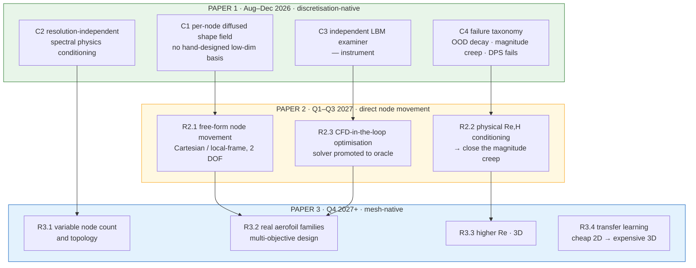
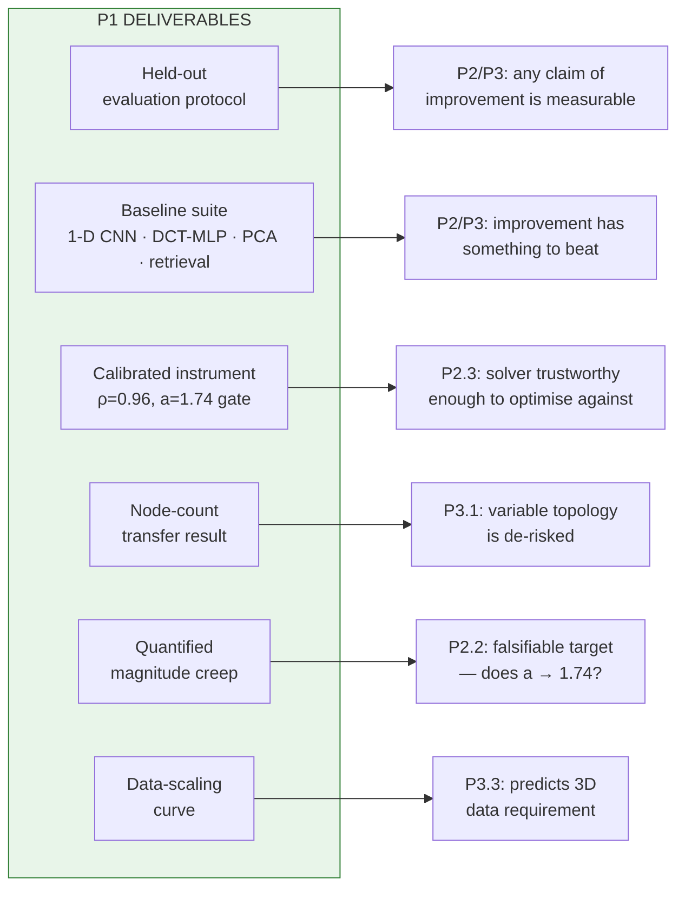
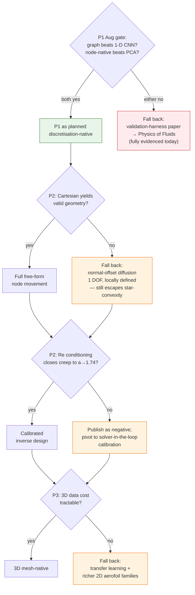
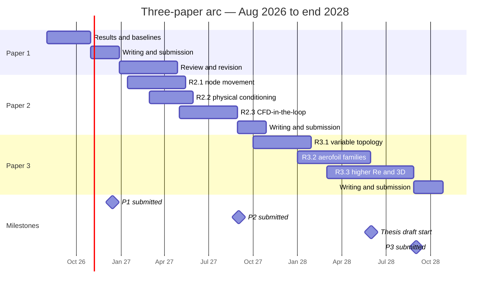

# Research programme — the three-paper arc

Umbrella plan for the publication series. Paper 1's detailed assessment and near-term schedule live in [[PUBLICATION_PLAN]]; running log in [[PUBLICATION_DIARY]].

**Organising principle: each paper earns exactly one word of the claim you eventually want.**

| Paper | Earns | Because |
|---|---|---|
| **P1** | *"discretisation-native"* | Per-node generation, no hand-designed low-dim basis — proven against non-graph and low-dim baselines |
| **P2** | *"direct node movement"* | Cartesian / local-frame per-node displacement, 2 DOF, validity-controlled |
| **P3** | *"mesh-native"* | Variable node count and topology, interior nodes, real design families |

Claiming all three now means defending all three for three years on evidence for one. Claiming them in sequence means every paper is honestly titled at the time of writing, and each one's reviewers hand you the next one's scope.

---

## 1. The arc

---

## 2. Dependencies for continuation

Nothing in P2 or P3 is startable without specific P1 deliverables. This is the argument for doing P1 properly rather than quickly.

**Read the two most important edges:**

- **`d4 → e4`** — P1's node-count transfer study (train at 96, sample at 48/192) is a one-week experiment that *de-risks the entire premise of P3*. If per-node generation does not survive a change of discretisation, "mesh-native" is dead and you want to know in September 2026, not in 2028.
- **`d5 → e5`** — P1 quantifies magnitude creep against a validated solver baseline of `a = 1.74`. That converts P2.2 from "try adding Re conditioning" into a **falsifiable hypothesis with a numeric target**. Without P1's number, P2.2 has no pass criterion.

---

## 3. Paper 2 — free-form node movement and physically-grounded conditioning

**Working title:** *"Free-form node movement in generative aerodynamic design: local-frame diffusion and physically-grounded conditioning."*
**Window:** Q1–Q3 2027 · **Venue candidates:** CMAME, SMO, JCP

### R2.1 — Free-form node movement

The claim P1 cannot make. `feature_mode="cartesian"` (2 DOF/node) exists in the dataset class and has never been trained; `EXPERIMENT_PLAN.md` flagged rotation ambiguity as the hazard and the experiment was dropped.

**The real hazards** — worth stating up front because they are why this is a paper and not a config change:

| Hazard | Consequence |
|---|---|
| Rigid-motion ambiguity | Translation/rotation are unconstrained → model wastes capacity on pose, not shape |
| Self-intersection | Nothing guarantees a simple closed curve; tangled boundaries are unmeshable |
| Node-spacing collapse | Nodes clump; the discretisation degrades even if the outline is fine |
| Permutation drift | Ring order can decohere from geometric order |

**Mitigation ladder** — deliberately ordered cheapest-first, so there is always a publishable rung:

1. **Normal-offset diffusion** *(recommended first rung)* — diffuse a scalar offset along the **local outward normal of a template**, not a radius from the centroid. Still 1 DOF, but *locally defined*, so it escapes radial's star-convexity limit and can represent concave regions. This is the cheap, high-probability win and the bridge between P1 and P2 — it is a strict generalisation of P1's representation.
2. **Tangent–normal decomposition** — 2 DOF expressed in the local frame, which eliminates global rigid-motion ambiguity by construction.
3. **Full Cartesian displacement from a template** — Procrustes canonical alignment, arc-length regulariser, self-intersection penalty.

**New metric required:** *validity rate* — the fraction of samples that are simple, closed, non-self-intersecting, adequately-spaced curves. P1 never needed this because radial parameterisation makes validity automatic. Losing that guarantee is the price of free movement, and measuring it is a genuine contribution.

**Why it matters beyond the claim:** star-convexity is what blocks aerofoils. Camber, concave pressure recovery regions, and anything with a reflex curve are unreachable from a centroid-radial field. R2.1 is therefore the *technical* prerequisite for P3.2, not just a claim upgrade.

### R2.2 — Physical conditioning and closing the calibration gap

P1 establishes that magnitude creep is model-side: real shapes grade at `a ≈ 1.74`, generated shapes at `a ≈ 2.5–3.5`, unmoved by any discretisation lever. P1 also declares the confound it cannot resolve — Re is fixed at 754 across the OOD ladder, so Cp-morphology and Reynolds extrapolation are entangled.

**Hypothesis (falsifiable, with P1's number as the target):** conditioning on physical `(Re, H)` alongside the Cp spectrum pulls the generated affine slope toward the validated 1.74.

Clean, quantitative, and it either works or it is a publishable negative. It also disentangles the two extrapolation axes P1 must leave confounded.

### R2.3 — CFD-in-the-loop optimisation: the instrument becomes an oracle

**This is the narrative payoff of P1's cleanest negative result.** P1 shows DPS fails because posterior guidance steers toward a *self-trained* pressure head that is unreliable exactly where it is needed. The obvious correction: replace the surrogate gradient with the real solver.

Approaches, cheapest-first:

| Approach | Mechanism | Solver cost |
|---|---|---|
| Iterative target refinement | Sample → solve → correct the conditioning target → resample | ~5–20 calls |
| Gradient-free search | CMA-ES / Bayesian optimisation over the conditioning vector or latent | ~50–200 calls |
| Finite-difference posterior | The DPS structure with real solver gradients replacing the head | ~100+ calls |

**Headline metric:** solver calls to reach a target, versus a conventional parameterised optimiser from the same budget. The interesting claim is not "we can optimise" but *"starting from a learned generative prior costs fewer solver calls than starting from a parameterisation"* — that is the practical case for the whole programme.

### ⚠️ P2 is probably two papers

R2.1 (representation) and R2.3 (optimisation) are independently substantial. **Planned split point:** if R2.1's validity work runs long, publish R2.1+R2.2 as P2 and promote R2.3 to P2b. Decide at the Q1 2027 review. Do not let a single paper carry both.

---

## 4. Paper 3 — genuinely mesh-native, and scale

**Working title:** *"Mesh-native generative design: variable-topology graph diffusion for aerodynamic shape families."*
**Window:** Q4 2027+ · **Venue candidates:** CMAME, JCP, Nature Comms Engineering (stretch)

### R3.1 — Variable node count and topology
The claim that finally earns "mesh-native": graphs of varying size, non-fixed topology, and interior/volume nodes rather than a boundary ring. Directly de-risked by P1's node-count transfer study — if that fails, this needs rethinking before it starts.

### R3.2 — Real aerofoil families and multi-objective design
**This is the strategic answer to P1's sharpest criticism.** A reviewer will reasonably ask why a 96-DOF generative model is needed for what is effectively a 2-parameter ellipse family — and on that test case, retrieval or a 10-mode PCA basis may genuinely suffice. That criticism *dissolves* in a real design space: camber, thickness distribution, AoA, and multi-objective targets (Cd **and** Cl, or a Cp target under a structural constraint), where the space is high-dimensional and sparsely sampled and lookup fails.

So P1 should **name this explicitly as where the representation's advantage is expected to appear**, rather than overclaiming it on ellipses. That is an honest limitation that doubles as the motivation for P3.

### R3.3 — Higher Reynolds number and 3D
The long-term target in `CLAUDE.md`. Needs turbulence modelling in the LBM (Smagorinsky/WALE) and 3D geometry handling. Data cost is the binding constraint, which is why R3.4 exists.

### R3.4 — Transfer learning: cheap 2D → expensive 3D
Pre-train on abundant cheap 2D data, fine-tune on scarce expensive 3D. **This is the fall-back option the viva panel asked for** in Part B3 ("reflection on risks, e.g. the anticipated dependency between shape complexity and training data size"). P1's data-scaling curve turns this from a hope into a **quantitative prediction**: extrapolate the curve to estimate the 3D data requirement, then test whether transfer beats the prediction.

---

## 5. Risk register and fall-backs

Directly serves viva Part B3. Every risk has a rung to fall back to — no branch of the programme dead-ends.

| # | Risk | Probability | Fall-back |
|---|---|---|---|
| R1 | Graph does not beat a 1-D CNN on 96 ordered nodes | **Medium** | Revert to the validation-harness framing — fully evidenced today, PoF-ready |
| R2 | Retrieval / PCA matches the model in-distribution | **Medium-high** | Reframe P1 as protocol + honest negative; the advantage claim moves to P3.2's richer space |
| R3 | Cartesian diffusion yields invalid geometry | Medium | Normal-offset diffusion (rung 1) — cheaper and still novel |
| R4 | Re conditioning does not close the creep | Medium | Publishable negative; solver-in-the-loop calibration instead |
| R5 | 3D/high-Re data cost prohibitive | **High** | Transfer learning from 2D; stay 2D with richer aerofoil families |
| R6 | CFD grading becomes the throughput bottleneck | **High — already true** | Surrogate for *screening only*, LBM for final grading. Never let the surrogate grade — that reintroduces the circularity P1 exists to break |

**R2 deserves emphasis.** It is the most likely to bite and the one that most changes the story. Note the fall-back is not failure: "we built a rigorous independent-physics evaluation protocol and found that on a simple design space a generative model is not yet justified over retrieval" is a genuinely useful, publishable finding. It is a *different* paper, not no paper.

**R6 is already the binding constraint** — see [[PUBLICATION_PLAN]] §11 for the run-count estimate.

---

## 6. Is this research worth publishing?

You argued: *it presents novel work, and as long as work goes as planned it yields real results as well as laying foundations for further research.* That is broadly right, but one part of it needs correcting.

### What is genuinely novel

- **The combination is new.** Graph diffusion over a boundary discretisation + fixed-size spectral physics conditioning + grading by an independent first-principles solver. Each ingredient exists; this assembly does not appear in the literature the work surveys.
- **The evaluation methodology is a contribution in its own right.** Most generative aerodynamic design papers grade with a surrogate trained on the same data that trained the generator — the model marks its own work. Breaking that circularity with an independent solver is a methodological point that stands alone, and it is why C4's findings are trustworthy at all.
- **The negative results are useful and rare.** "Posterior guidance from a self-trained head degrades OOD fidelity monotonically" and "the amplitude bias is generative, not discretisation-related" are the kind of findings that save other groups months and almost never get published.

### The honest case against

One criticism is sharp and you should rehearse it: **the test case is a two-parameter family (Re, `b`) sampled by 5701 simulations.** A reviewer will ask why a 96-DOF generative model is warranted for that, and on this dataset retrieval or a 10-mode PCA basis may match you. If they do, the representational claim is not *wrong*, it is *undemonstrated on a case that could demonstrate it*.

The answer is not to dodge it. It is: the method is developed and validated on a controlled case where independent ground truth is obtainable, the contributions are the representation and the protocol, and the advantage is expected to appear where the design space is genuinely high-dimensional — which is named as P3.2 rather than overclaimed here.

### One correction to your reasoning

> *"...as well as laying the foundations for the further research"*

This is a real and legitimate reason for **you** to publish P1 — it front-loads the protocol, gets the baselines reviewed early, and makes P2/P3 defensible. Keep it as a programme rationale.

But **it is not a contribution a reviewer credits.** Reviewers assess the paper standalone; "this enables our future work" is not an argument that survives peer review. So the foundation value should shape *what you do* and never appear as *why the paper matters*. P1 must justify itself on the representation, the protocol, and the findings alone.

### Verdict

**Yes — worth publishing, as a foundations-and-protocol paper rather than a performance paper.** Two conditions:

1. **Do not claim performance superiority you have not measured.** Claim the representation, the protocol, and the failure taxonomy.
2. **The verdict is contingent on the August gate.** If the graph loses to a 1-D CNN *and* retrieval matches the model, the honest paper is a smaller one — a protocol-and-negative-result paper, still publishable, at a workshop or MLST. Which paper you have is a fact you will learn in August; write after that, not before.

Your instinct to publish early and build is right, and the three-paper arc is the correct vehicle for it. Publishing early is only a good strategy if each paper's claims are *sized to its evidence* — which is exactly what the one-word-per-paper discipline enforces.

---

## 7. Programme timeline

Note the deliberate overlaps: P2's conditioning work runs alongside R2.1, and P3.1 starts while P2 is under review. Review latency is dead time for the paper but not for the programme — that is the main structural argument for publishing early and often rather than accumulating one large submission.

---

## 8. Review checkpoints

The value of the three-paper structure is that each submission forces external scrutiny before the next builds on it.

| Checkpoint | When | Question |
|---|---|---|
| **P1 August gate** | Sep 2026 | Does the graph earn its place? Does node-native beat a low-dim basis? *(may reframe P1)* |
| **P1 reviews** | ~Q1–Q2 2027 | What do reviewers attack? Feed directly into P2's scope |
| **P2 split decision** | Q1 2027 | Does R2.3 need its own paper? |
| **P2 validity gate** | Q2 2027 | Does free-form movement produce valid geometry, or fall back to normal-offset? |
| **P3 scope decision** | Q3 2027 | 3D, or richer 2D families? Decided by P1's data-scaling curve and R5 |
| **Thesis assembly** | Q2 2028 | Three published chapters plus the integrating narrative |

Each paper's reviews are free scope-setting for its successor. That is worth more than the time lost to review latency.
